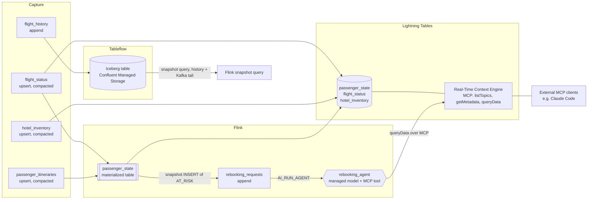
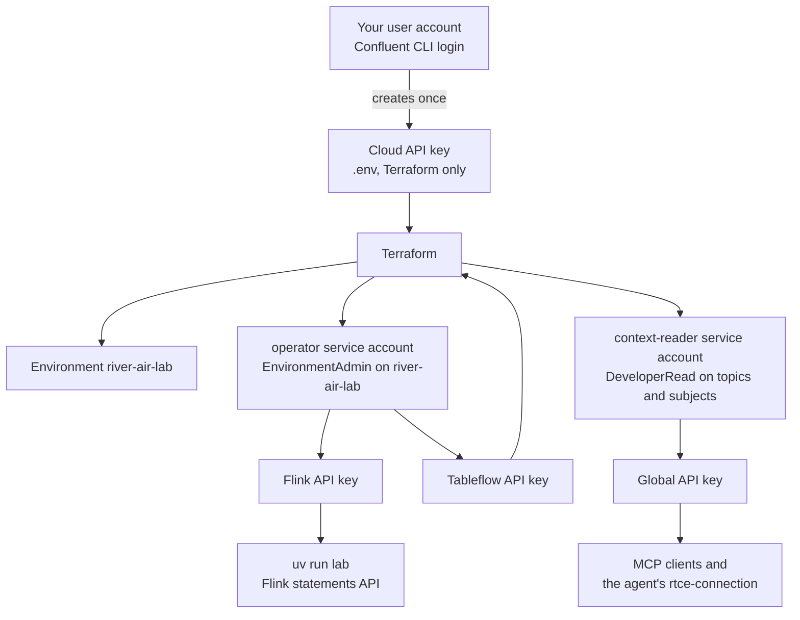

# Architecture

## The Streamhouse idea

A Streamhouse keeps the current state of the business continuously computed and serves that one state to applications, AI agents, and analytics.
Confluent builds it from four managed layers on top of Kafka topics:

1. **Capture**: Kafka topics hold the events, with schemas in Schema Registry.
2. **Maintain**: Flink SQL, and in particular materialized tables, turn events into always-current state.
3. **Serve now**: Lightning Tables answer low-latency point and range reads over a topic's latest state, for apps (query API, JDBC, CLI) and for agents (the Real-Time Context Engine over MCP).
4. **Serve history**: Tableflow writes the same topics to Iceberg tables, so snapshot queries and external engines read history without a separate pipeline.

The topic is the contract between the layers.
Each layer reads a topic that another layer wrote, so no component needs a copy of another's logic.

## River Air in this lab

| Capability | Component | Lab object | Managed by |
|---|---|---|---|
| 1 | Kafka topics with schemas | `flight_status`, `passenger_itineraries`, `hotel_inventory` | `sql/01-sources` |
| 2 | Flink SQL joins and transforms | bounded join in `sql/02-transform/checks` | `uv run lab check transform` |
| 3 | Materialized table | `passenger_state` | `sql/03-passenger-state` |
| 4 | Lightning Tables | RTCE topics on three topics | `terraform/lightning.tf` |
| 5 | Tableflow to Iceberg | `flight_history` | `sql/05-history`, `terraform/tableflow.tf` |
| 6 | Agent over MCP | model, tool, agent, `rtce-connection` | `sql/06-agent`, `uv run lab agent-connection` |

## Control plane and credentials

- The only secret a person handles is the Cloud API key in `.env`.
- Every other key is created by Terraform for a service account, stored in Terraform state (owner-only, gitignored), and read into memory by `uv run lab` when needed.
- The agent and MCP clients use the context reader's key, which can read data but cannot change anything.

## Where the boundaries are

These boundaries come from the documentation and decide where logic goes:

- Joins, aggregations, and enrichment run in Flink.
  Lightning queries are single-topic and reject GROUP BY, COUNT, and OFFSET.
- Lightning serves current state.
  It updates within 100 ms of data arriving in the topic, but a Flink output topic only receives data at Flink's commit interval, so derived state is as fresh as Flink's checkpoint, not Lightning's ingest.
- Tableflow serves history.
  Flink can read it only with snapshot queries, which combine the Iceberg snapshot with the Kafka tail.
- Agents read append-only input.
  `AI_RUN_AGENT` cannot consume the upsert `passenger_state` directly, hence `rebooking_requests`.

Phase 4 measures how these boundaries behave in practice; see [experiments](experiments/README.md).
