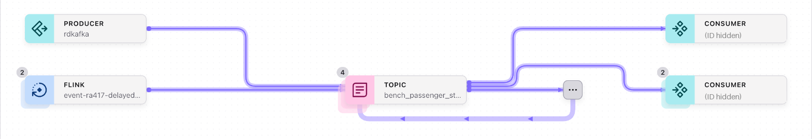

*Part 1 of [Building a Streamhouse on Confluent Cloud](index.md).*

## What a Streamhouse is

Confluent builds a Streamhouse from four managed layers on top of Kafka topics.
Kafka topics hold the events, with their schemas in Schema Registry.
Flink SQL, mostly through materialized tables, turns those events into state that stays current.
Lightning Tables serve a topic's latest state for fast reads, to applications through an API and to agents through the Real-Time Context Engine, which is an MCP server.
Tableflow writes the same topics out as Iceberg tables, so history does not need a second pipeline.

The layers exchange data through Kafka topics, so the derived-state definition stays in Flink instead of being reimplemented in a serving database or export pipeline.

## The scenario

Confluent's quick start uses a fictional airline, River Air.
Flight RA417 from Chicago is late into San Francisco.
The system has to work out which connecting passengers are now at risk, have an AI agent offer each of them two new flights and a hotel if they need one, and answer questions about past delays.

This is the console's Stream Lineage summary for the lab's cluster over the last hour:

*Confluent Cloud console, 2026-11-15, cluster overview, period "Last hour". Consumer IDs are hidden.*

The summary groups nodes and puts the count in a badge.
On the left are the writers: `rdkafka` is the benchmark's data generator, and the two Flink `INSERT` statements replayed the RA417 events.
The four topics sit in the middle.
The tooltip on the `…` node says "flink · 2", meaning two Flink nodes that read the topics and write back into them.
In this lab only the two materialized tables do both, so I'm fairly sure that's what they are.
The consumers on the right are named as managed tasks of the environment, and the summary doesn't say which service each one belongs to.

Lineage only shows recent traffic, so I replayed a few events right before taking this.
The full Stream Lineage page showed nothing but its onboarding screen for this environment, which is on the Essentials governance package.

## How the lab is built

The [quick start](https://github.com/confluentinc/quickstart-streamhouse) is a 30-minute walkthrough in the console.
I wanted something I could tear down every evening and rebuild the next morning, where I could review every step before it cost money.

Terraform owns the infrastructure: one environment, one cluster, one Flink compute pool, two service accounts with their keys, the Lightning Tables, and the Tableflow table.
The Lightning Tables and Tableflow are switched on by variables, because they need topics that Flink creates first.

The Flink objects live in SQL files, one statement per file, and a small CLI applies them in order through the Flink statements API.
A header comment such as `-- lab:mode=snapshot` makes a file run as a snapshot (batch) query.

I used the Confluent CLI in one place, where neither of those works.
Terraform has no `MCP_SERVER` connection type yet, so the agent's MCP connection comes from `confluent flink connection create`.

About 120 offline unit tests cover the SQL files, the clients, secret handling, and the benchmark tooling.
Six live tests, one per capability, check the quick start's expected results against the real deployment and take about three minutes.

I changed two things from the quick start:

| Quick start | This lab | Why |
|---|---|---|
| Standard cluster | Basic cluster | Every feature used here runs on Basic, and Basic's first eCKU is free; Standard starts at $0.75 per eCKU-hour |
| Global API key for your own user | Global API key for a dedicated service account, created by Terraform | Keeps the user's two Global key slots free and puts the key's lifecycle in code |

The second change led to the most interesting problem of the project, which is the subject of [part 2](02-basic-clusters-and-read-only-agents.md).

## Verify the docs before trusting them

Some of what I read had already drifted, so I checked these instead of assuming:

- The Lightning query API is at `query/v1`. The upstream quick start repository still calls `query/v1alpha1`.
- The upstream repository says Terraform cannot create Global API keys. Provider 2.95.0 can.
- Enabling a Lightning Table on a topic and enabling the Real-Time Context Engine on it create the same API object, `rtce-topics`, which Terraform manages as `confluent_rtce_topic`.

## What passed

All six capabilities matched the quick start, including the agent's output:

| # | Capability | Result |
|---|---|---|
| 1 | Source tables and sample events | Matched |
| 2 | A Flink join as a bounded snapshot query | Matched |
| 3 | `passenger_state` materialized table, then the RA417 delay | `P-001` and `P-002` flipped from `OK` to `AT_RISK` |
| 4 | Lightning Tables through MCP | Matched, with a permission change |
| 5 | Tableflow history | Matched in Flink and directly in Iceberg |
| 6 | Rebooking agent | `OFFER1=RA226;OFFER2=RA232;HOTEL=Harbor Point Hotel` for both passengers |

## What it costs

An idle platform costs almost nothing.
A Basic cluster with no traffic, a compute pool with no statements, and Schema Registry Essentials are not billed.
You pay for what runs:

- A materialized table is a continuous statement and uses at least one Flink CFU for as long as it exists.
  An earlier invoice of mine charged $0.2562 per CFU-hour in Seoul (I haven't checked the `us-east-1` rate), which works out to about $6 a day.
- A Tableflow topic is billed by the hour while it's enabled, even when no new data arrives.
- Lightning Tables always bill for storage, and bill for compute only while data arrives or queries run.
- The agent bills for model inference on each run.

Since everything is in code, I tore the lab down between sessions, which is the cheapest way to run it.

Next: [Basic clusters cannot hold a read-only agent](02-basic-clusters-and-read-only-agents.md).
