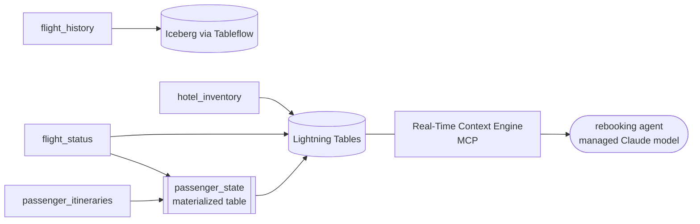

*Part 1 of [Building a Streamhouse on Confluent Cloud](index.md).*

## What a Streamhouse is

Confluent's Streamhouse is four managed layers on top of Kafka topics:

1. **Capture.** Kafka topics hold the events, with schemas in Schema Registry.
2. **Maintain.** Flink SQL, and especially materialized tables, turn events into always-current state.
3. **Serve now.** Lightning Tables answer low-latency reads over a topic's latest state, for applications through an API and for agents through the Real-Time Context Engine, an MCP server.
4. **Serve history.** Tableflow writes the same topics to Iceberg tables, so history needs no second pipeline.

The topic is the contract between the layers.
Each layer reads what another layer wrote, so no component needs a copy of another's logic.

## The scenario

Confluent's quick start uses a fictional airline, River Air.
Flight RA417 from Chicago is late into San Francisco.
The system has to notice which connecting passengers are now at risk, let an AI agent offer each of them two new flights and, if needed, a hotel, and answer questions about past delays.

Here is what the console's Stream Lineage summary showed for the lab's cluster, for the last hour:

*Confluent Cloud console, 2026-11-15, cluster overview, period "Last hour". Consumer IDs are hidden.*

The summary groups nodes, and the badges count them.
On the left are the two kinds of writers: `rdkafka`, the benchmark's data generator, and two Flink `INSERT` statements that replayed the RA417 events.
In the middle are four topics.
The `…` node is, by its tooltip, two aggregated Flink nodes: the two materialized tables, which read the topics and write their results back into the topic group.
On the right are the readers, which include Lightning Tables.

Two practical notes: lineage only shows recent traffic, so I replayed a few events before taking this; and the full Stream Lineage page showed only its onboarding screen for this environment, which uses the Essentials governance package.

## How the lab is built

The quick start is a 30-minute walkthrough in the console.
I wanted something I could tear down every evening and rebuild the next morning, with every step reviewable before it cost money.

- **Terraform** owns the infrastructure: one environment, one cluster, one Flink compute pool, two service accounts and their keys, the Lightning Tables, and the Tableflow table.
  Lightning Tables and Tableflow sit behind variables, because they need topics that Flink creates first.
- **SQL files** own the Flink objects, one statement per file, applied in order by a small CLI over the Flink statements API.
  A header comment such as `-- lab:mode=snapshot` turns a file into a snapshot (batch) query.
- **The Confluent CLI** is used only where neither works: Terraform has no `MCP_SERVER` connection type yet, so the agent's MCP connection is created with `confluent flink connection create`.
- **Tests** come in two kinds.
  About 120 offline unit tests check the SQL files, the clients, secret handling, and the benchmark tooling.
  Six live tests, one per capability, assert the quick start's expected results against the real deployment, in about three minutes.

Two choices differ from the quick start:

| Quick start | This lab | Why |
|---|---|---|
| Standard cluster | Basic cluster | Every feature used here runs on Basic, and Basic's first eCKU is free; Standard starts at $0.75 per eCKU-hour |
| Global API key for your own user | Global API key for a dedicated service account, created by Terraform | Keeps the user's two Global key slots free and puts the key's lifecycle in code |

The second choice turned out to be the most interesting problem of the project; see [part 2](02-basic-clusters-and-read-only-agents.md).

## Verify the docs before trusting them

A few things I checked instead of assuming, because they had already drifted:

- The Lightning query API is at `query/v1`; the upstream quick start repository still calls `query/v1alpha1`.
- The upstream repository says Terraform cannot create Global API keys; provider 2.95.0 can.
- Enabling a Lightning Table and enabling the Real-Time Context Engine on a topic are the same API object, `rtce-topics`, which Terraform manages as `confluent_rtce_topic`.

## What passed

All six capabilities matched the quick start, including the agent's output:

| # | Capability | Result |
|---|---|---|
| 1 | Source tables and sample events | Matched |
| 2 | A Flink join as a bounded snapshot query | Matched |
| 3 | `passenger_state` materialized table, then the RA417 delay | `P-001` and `P-002` flipped from `OK` to `AT_RISK` |
| 4 | Lightning Tables through MCP | Matched, with a permission change |
| 5 | Tableflow history | Matched in Flink and directly in Iceberg |
| 6 | Rebooking agent | `OFFER1=RA226;OFFER2=RA232;HOTEL=Harbor Point Hotel` for both passengers |

## What it costs

The idle platform costs almost nothing: a Basic cluster with no traffic, a compute pool with no statements, and Schema Registry Essentials are not billed.
The running parts are what cost money:

- A materialized table is a continuous statement and uses at least one Flink CFU for as long as it exists.
  At the $0.2562 per CFU-hour on an earlier invoice of mine (in Seoul; I have not checked the `us-east-1` rate), that is about $6 per day.
- A Tableflow topic is billed per hour while enabled, even with no new data.
- Lightning Tables bill storage always and compute only while data arrives or queries run.
- The agent bills model inference per run.

Because everything is in code, tearing the lab down between sessions is the cheapest way to run it.

Next: [Basic clusters cannot hold a read-only agent](02-basic-clusters-and-read-only-agents.md).
