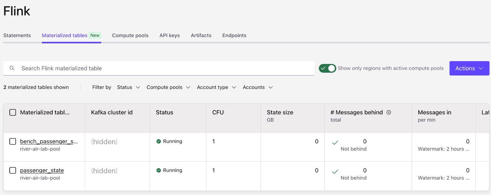
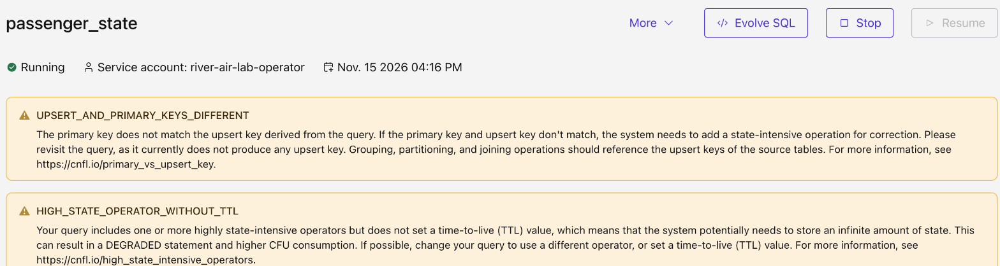

A Flink materialized table on Confluent Cloud is a single object that owns a table definition, its backing compacted topic, its schema, and the continuous query that fills it.
River Air's `passenger_state` joins every itinerary to its inbound and onward flights and keeps one row per passenger with a risk flag.

```sql
CREATE MATERIALIZED TABLE passenger_state (
  PRIMARY KEY (passenger_id) NOT ENFORCED
)
DISTRIBUTED BY (passenger_id) INTO 1 BUCKETS
WITH ('changelog.mode' = 'upsert')
AS SELECT
  p.passenger_id,
  ...
  CASE
    WHEN p.connecting_flight_id IS NULL THEN 'NO_CONNECTION'
    WHEN TIMESTAMPDIFF(MINUTE, inbound.estimated_time,
                       onward.estimated_time) < 45 THEN 'AT_RISK'
    ELSE 'OK'
  END AS risk
FROM passenger_itineraries p
JOIN flight_status inbound ON p.inbound_flight_id = inbound.flight_id
LEFT JOIN flight_status onward ON p.connecting_flight_id = onward.flight_id;
```

It did what the docs promise.
When RA417 was delayed, `P-001` and `P-002` flipped to `AT_RISK` and nobody touched the definition.
Three other things took me longer to work out.

## 1. The running query is not in the statement list

Right after I submitted it, the `CREATE MATERIALIZED TABLE` statement showed as `RUNNING`.
A few minutes later it showed as `COMPLETED`, as a bounded statement.
Nothing in the statement list was running any more, and the table kept updating anyway.

The console splits it the same way.
On the Statements tab, both materialized tables in the lab (the quick start's and a load-test copy) show up only as completed `CREATE MATERIALIZED TABLE` statements:

[](assets/flink-statements-mt-completed.png)

The Materialized tables tab next to it shows both running, each holding one CFU:

[](assets/flink-mt-running.png)

*Confluent Cloud console, 2026-11-15. The cluster ID column is hidden. Click any screenshot for full size.*

In the API, the continuous query is under `GET /sql/v1/.../materialized-tables`, which reports its own phase, version, and a `stopped` flag:

```
materialized tables (continuous queries; billed while RUNNING):
  RUNNING    passenger_state v1
```

Stream Lineage does show them, as Flink nodes between the source topics and their output ([part 1](01-the-lab.md) has the screenshot).

If you monitor or clean up Flink by listing statements, you will miss the part that is billed around the clock.
The lab's status command now reads both lists.

> **Operational trap:** A clean statement list does not mean Flink has stopped consuming CFUs. Materialized tables have their own lifecycle and status API.

## 2. The official example carries two CRITICAL warnings

The materialized-table API also returns warnings.
For the quick start's query, copied exactly from the documentation, it returned two, both `CRITICAL`:

- `UPSERT_AND_PRIMARY_KEYS_DIFFERENT`: the declared primary key, `passenger_id`, is not the upsert key Flink derives from the query, so Flink adds a state-intensive correction step.
- `HIGH_STATE_OPERATOR_WITHOUT_TTL`: the regular joins keep state forever because no time-to-live is set, which can degrade the statement and raise CFU use.

The console shows both at the top of the table's page:

[](assets/flink-mt-warnings.png)

With three passengers the warnings had no visible effect, although the materialized table still held one billed CFU.
At production scale I'd address them separately: redesign the query or key so the derived upsert key matches the declared primary key, and add a state TTL to bound the joins.
Changing a materialized table can throw away state and rebuild it, and in upsert mode it can leave stale keys that the new query no longer emits.

## 3. The settings that decide freshness

The resolved table options include:

```
'confluent.sink.buffer-flush.enabled'  = 'true'
'confluent.sink.buffer-flush.interval' = '5 s'
'kafka.cleanup-policy'                 = 'compact'
'key.format'                           = 'avro-registry'
'value.format'                         = 'avro-registry'
```

With a 5-second flush I expected downstream readers to see changes within a few seconds.
In my measurements, derived state reached Lightning Tables in steps about a minute apart.
Flink commits its output transaction about once a minute, as Confluent's [delivery guarantees page](https://docs.confluent.io/cloud/current/flink/concepts/delivery-guarantees.html) documents for the default exactly-once mode, and readers that only see committed data, Lightning included, wait for that commit.
[Part 6](06-how-fresh-is-real-time.md) breaks the time down.

## Smaller notes

- A bounded copy of the same join, run as a snapshot query, finished in about 10 seconds and raised no state warnings.
  For exploring, I'd use snapshot queries and only make a materialized table when the result has to stay current.
- A materialized table is billed for at least one CFU for as long as it exists.
  You can stop it through the API or with Terraform's `stopped = true` without dropping it.
