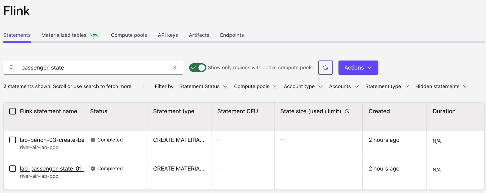

*Part 3 of [Building a Streamhouse on Confluent Cloud](index.md).*

A Flink materialized table on Confluent Cloud is one object that owns a table definition, its backing compacted topic, its schema, and the continuous query that fills it.
River Air's `passenger_state` joins every itinerary to its inbound and onward flights and keeps one row per passenger with a risk flag.

```sql
CREATE MATERIALIZED TABLE passenger_state (
  PRIMARY KEY (passenger_id) NOT ENFORCED
)
DISTRIBUTED BY (passenger_id) INTO 1 BUCKETS
WITH ('changelog.mode' = 'upsert')
AS SELECT
  p.passenger_id,
  ...
  CASE
    WHEN p.connecting_flight_id IS NULL THEN 'NO_CONNECTION'
    WHEN TIMESTAMPDIFF(MINUTE, inbound.estimated_time,
                       onward.estimated_time) < 45 THEN 'AT_RISK'
    ELSE 'OK'
  END AS risk
FROM passenger_itineraries p
JOIN flight_status inbound ON p.inbound_flight_id = inbound.flight_id
LEFT JOIN flight_status onward ON p.connecting_flight_id = onward.flight_id;
```

It worked as advertised: when RA417 was delayed, `P-001` and `P-002` flipped to `AT_RISK` without anyone touching the definition.
Three things were less obvious.

## 1. The running query is not in the statement list

Right after submission, the `CREATE MATERIALIZED TABLE` statement showed as `RUNNING`.
A few minutes later it showed as `COMPLETED`, reported as a bounded statement.
Nothing in the statement list was running any more, yet the table kept updating.

The console shows the same split.
On the Statements tab, both materialized tables in the lab (the quick start's and a load-test copy) appear only as completed `CREATE MATERIALIZED TABLE` statements:

[](assets/flink-statements-mt-completed.png)

The Materialized tables tab, one click away, shows them running, each holding one CFU:

[](assets/flink-mt-running.png)

*Confluent Cloud console, 2026-11-15. The cluster ID column is hidden. Click any screenshot for full size.*

In the API, the continuous query lives under `GET /sql/v1/.../materialized-tables`, which reports its own phase, version, and a `stopped` flag:

```
materialized tables (continuous queries; billed while RUNNING):
  RUNNING    passenger_state v1
```

Stream Lineage, on the other hand, does show them: as Flink nodes between the source topics and their output ([part 1](01-the-lab.md) has the screenshot).

If you monitor or clean up Flink by listing statements, you will miss the one thing that is billed continuously.
My lab's status command now reads both lists.

## 2. The official example carries two CRITICAL warnings

The materialized-table API also returns warnings.
For the quick start's query, verbatim from the documentation, it returned two, both `CRITICAL`:

- `UPSERT_AND_PRIMARY_KEYS_DIFFERENT`: the declared primary key, `passenger_id`, is not the upsert key Flink derives from the query, so Flink adds a state-intensive correction step.
- `HIGH_STATE_OPERATOR_WITHOUT_TTL`: the regular joins keep state forever because no time-to-live is set, which can degrade the statement and raise CFU use.

The console puts both warnings at the top of the table's page:

[](assets/flink-mt-warnings.png)

At three passengers this costs nothing.
At production scale both are worth fixing, and `CREATE OR ALTER MATERIALIZED TABLE` with a state TTL is the natural way to do it.
Keep in mind that an evolution discards state and rebuilds it, and in upsert mode can leave stale keys that the new query no longer emits.

## 3. The settings that decide freshness

The resolved table options include:

```
'confluent.sink.buffer-flush.enabled'  = 'true'
'confluent.sink.buffer-flush.interval' = '5 s'
'kafka.cleanup-policy'                 = 'compact'
'key.format'                           = 'avro-registry'
'value.format'                         = 'avro-registry'
```

A 5-second flush suggests downstream readers might see changes within seconds.
They do not.
In my measurements, derived state reached Lightning Tables in steps about 61 seconds apart, which points to Flink's commit interval, not the flush, as the clock that matters.
[Part 6](06-how-fresh-is-real-time.md) has the numbers.

## Two small practical notes

- A bounded copy of the same join, run as a snapshot query, finished in about 10 seconds and carried no state warnings.
  For exploration, prefer snapshot queries; make it a materialized table only when it needs to stay current.
- A materialized table is billed for at least one CFU for as long as it exists.
  It can be stopped through the API or with Terraform's `stopped = true` without dropping it.

Next: [Proving that Tableflow wrote Iceberg](04-proving-tableflow-wrote-iceberg.md).
