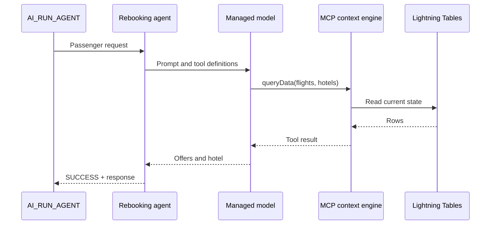

## The agent stack

The rebooking agent is three Flink SQL objects and one connection:

```sql
CREATE MODEL rebooking_model
INPUT (prompt STRING) OUTPUT (response STRING)
WITH ('provider' = 'confluent', 'task' = 'text_generation',
      'confluent.model' = 'anthropic.claude-sonnet-4-6');

CREATE TOOL river_air_live_context
USING CONNECTION `rtce-connection`
WITH ('type' = 'mcp',
      'allowed_tools' = 'getMetadata,queryData',
      'request_timeout' = '30');

CREATE AGENT rebooking_agent
USING MODEL rebooking_model
USING PROMPT '... offer the first two flights from SFO to the final
destination that leave at least 45 minutes after arrival, skip CANCELLED
flights, and add the first hotel alphabetically with rooms if an offer
leaves 6 or more hours later ... Reply with exactly one line:
OFFER1=<flight_id>;OFFER2=<flight_id>;HOTEL=<hotel or NONE>'
USING TOOLS river_air_live_context
WITH ('max_iterations' = '10');
```

The model is managed, meaning it runs inside Confluent Cloud and needs no endpoint or API key.
`SHOW MODELS` in `us-east-1` listed Claude Sonnet 4.6, Opus 4.6, 4.7 and 4.8, Haiku 4.5, three Amazon Nova models, and two others.

The tool is the Real-Time Context Engine's MCP server, limited to `getMetadata` and `queryData`.

The connection holds the MCP endpoint and the context reader's Global API key.
Terraform can't create this kind of connection yet, so the lab uses `confluent flink connection create`.



## The append-only input boundary

`AI_RUN_AGENT` reads only append-only input, and `passenger_state` is an upsert table.
So the lab copies at-risk passengers into an append-only `rebooking_requests` table and runs the agent over that:

```sql
SELECT q.passenger_id, r.agent_status, r.response
FROM rebooking_requests AS q,
LATERAL TABLE(AI_RUN_AGENT(
  'rebooking_agent',
  CONCAT('passenger_id=', q.passenger_id,
         '; final_destination=', q.final_destination,
         '; inbound_arrival=', CAST(q.inbound_arrival AS STRING)),
  q.passenger_id
)) AS r(agent_status, response);
```

## Observed result

```
P-001  SUCCESS
  The first available hotel alphabetically is **Harbor Point Hotel**.

  OFFER1=RA226;OFFER2=RA232;HOTEL=Harbor Point Hotel

P-002  SUCCESS
  The first hotel alphabetically with available rooms is **Harbor Point Hotel**.

  OFFER1=RA226;OFFER2=RA232;HOTEL=Harbor Point Hotel
```

That's exactly the answer the quick start expects.
The agent skipped RA214, which now leaves only 40 minutes after the delayed arrival.
It added a hotel because RA232 leaves the next morning, and it passed over the sold-out Airport Bayfront Inn.
The prompt contains no flight or hotel data, so the agent got all of this from live Lightning reads.

## Does it see a change?

The answer above came from data that had been sitting still.
To see whether the agent reads the state as it is when it runs, I changed the data under it twenty times.

Each cycle put RA214 back on time, waited until Lightning served it that way, and then delayed it from 15:30 to 16:00.
That one change moves every part of the right answer: RA214 now leaves 70 minutes after the 14:50 landing, so it becomes the first offer, and neither offer leaves six hours later, so no hotel is needed.

```
before  OFFER1=RA226;OFFER2=RA232;HOTEL=Harbor Point Hotel
after   OFFER1=RA214;OFFER2=RA226;HOTEL=NONE
```

The agent ran 0, 5, 15, or 30 seconds after the delay was written, five times each, in shuffled order.

| | Runs | Answered from the new data | From the old data | No offer line | p50 | max |
|---|---|---|---|---|---|---|
| In-Flink agent (two passengers per run) | 20 | 40 of 40 | 0 | 0 | 18.4 s | 22.9 s |

Every answer used the new data, even at 0 seconds.
In the same cycles, a separate poller found the delay already served by Lightning on its first query, within a second of the event's Flink statement reporting that it had finished.
So the agent did read live state, but this run could not show a window in which it would answer from stale data: Lightning was faster than the shortest offset.
[Part 6](06-how-fresh-is-real-time.md) measures that serving delay directly.

## Operational limits

The model didn't reply with exactly one line in any of the 40 answers, despite the prompt; it put a sentence of reasoning in front.
The quick start warns about this.
Anything that consumes the response should look for the `OFFER1=` line instead of parsing the whole field, which is what the lab's test does.

A run for two passengers took 18 to 23 seconds end to end, including snapshot query start-up, the model calls, and the MCP calls.
`AI_RUN_AGENT` takes a system log table as an optional fourth argument and writes every model call and tool call of a run to it.
With one in place, every one of the 40 answers took three model calls and three tool calls.

The agent's tools are read-only, but its credential is broader.
On a Basic cluster the context reader's key holds `CloudClusterAdmin` ([part 2](02-basic-clusters-and-read-only-agents.md)).

Creating the connection with the CLI keeps the secret out of SQL history, and `confluent flink connection describe` doesn't return it.
The CLI does take the secret as a command-line argument, so it shows up briefly in the local process list.

## If the connection disappears

I deleted the agent's MCP connection five seconds into a run.
That run finished normally, with correct answers, 27 seconds later.
The next run failed in under a second with an error that names the wrong thing:

```
Agent '`river-air-lab`.`river-air`.`rebooking_agent`' does not exist.
```

The agent still existed.
Recreating only the connection, under the same name, made the next run succeed with no change to the agent, its tool, or its model.
If you see that error, check the connection behind the agent's tool before you recreate the agent.

## An external MCP client on the same data

Any authorized MCP client can read the Lightning Tables; the agent inside Flink is just one of them.
To compare, I ran the same task in Claude Code, headless, in the same twenty cycles.
It got the agent's prompt as its system prompt, the same model (`claude-sonnet-4-6`), no built-in tools, and only the same two context tools.

| | Runs | Answered from the new data | No offer line | Tool calls | p50 | max |
|---|---|---|---|---|---|---|
| Claude Code, first run | 20 | 17 | 3 | 2 to 5 | 16.8 s | 20.6 s |
| Claude Code, with `listTopics` hidden | 20 | 20 | 0 | 3 | 15.8 s | 20.3 s |

The three misses in the first run were my setup.
The engine serves a third tool, `listTopics`, which the Flink tool leaves out with `allowed_tools`.
Claude Code still showed it to the model without allowing it, and when the model called it, the run stopped to ask for permission.
Hiding it, so both agents saw the same two tools, fixed that.

With the same model and tools, the two agents answered the same way and made the same three tool calls per answer.
The difference is in how they're run: the Flink agent is a statement over a table of requests, billed on the Confluent invoice and logged to a table, while Claude Code is a process you run and secure yourself, at about $0.035 per answer here.
Both read one continuously maintained table instead of their own copies, which is what a Streamhouse is for.
