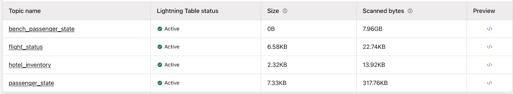

According to the [Lightning Tables documentation](https://docs.confluent.io/cloud/current/lightning-tables/overview.html), a table updates within 100 ms of new data arriving in its topic.
That number covers only the serving layer.
Confluent's [delivery guarantees page](https://docs.confluent.io/cloud/current/flink/concepts/delivery-guarantees.html) documents another part of the path: Flink writes to Kafka in transactions that commit approximately every minute, so under the default exactly-once guarantee, each statement whose output a consumer reads adds up to about a minute.
An application cares about the whole path, from a source change through Flink to a read of the derived state, so that's what I measured.

## Setup

| Item | Value |
|---|---|
| Region | AWS `us-east-1`, Basic cluster, Flink pool with at most 5 CFU |
| Data | A seeded generator: 1,021 flights and 10,000 passengers, written to separate `bench_` tables so the quick start data stays untouched |
| Check | The bench materialized table converged to exactly the risk counts the generator predicted: 6,387 OK, 2,103 AT_RISK, 1,510 NO_CONNECTION |
| Read path | Real-Time Context Engine over MCP, one long-lived session per client |
| Client | A laptop in Seoul |
| Network | 190 to 210 ms TCP connect to the MCP host, measured before and after every run |

Every latency below includes that trans-Pacific round trip.
The results describe this configuration, with one materialized table between the source topic and Lightning and Flink's default exactly-once delivery; they are not general limits of a Streamhouse.
The percentiles are nearest-rank, so each one is a value I actually observed.

## Freshness experiment design

For each sample, the client writes a flight update with a unique `estimated_time` through the Kafka producer (`acks=all`) and records when the broker acknowledged it.
Then it polls `queryData` for the probe passenger's `INBOUND_ARRIVAL` until the new value shows up.

Each sample records two times.
"Not visible before" is the start of the last poll that missed the value, and "visible by" is the end of the first poll that saw it.
The real visibility time is somewhere in between.
The gap between the two was 1.6 to 2.9 s, median 1.8 s, which is the measurement's resolution; one MCP query takes about 0.8 s from Seoul.

## The benchmark trap in the first run

The first run of 30 samples reported a median of 55.9 s and a maximum of 59.7 s.
The first sample on its own was 17.4 s, though, and the other 29 all fell between 52.5 and 59.7 s.

The visibility times gave it away: 08:02:58, 08:03:59, 08:05:01, and so on, one every 61 to 62 seconds.
My runner wrote each new sample 5 seconds after it saw the previous one.
A change only becomes visible right after a Flink commit, so every write landed just after a commit and waited almost a full interval for the next one.
I had built a benchmark that synchronized itself with the system it was measuring.

That run doesn't describe freshness, but it does show two things.
Derived state reaches Lightning in steps about 61 seconds apart, and a write that just misses a commit takes about 56 to 60 seconds to show up.

To fix it, I spread the writes across the interval: 5 seconds plus a seeded random 0 to 60 seconds between samples.

## End-to-end freshness result

With jitter, 30 samples, from broker acknowledgement to visible in Lightning:

| min | p50 | p95 | max | mean |
|---|---|---|---|---|
| 17.8 s | 46.1 s | 66.9 s | 67.6 s | 42.4 s |

All 30 values, sorted: 17.8, 19.1, 20.6, 21.1, 23.9, 25.0, 30.0, 30.6, 32.6, 34.3, 36.1, 37.3, 38.8, 42.3, 46.1, 46.6, 47.4, 47.8, 48.6, 50.0, 50.2, 51.4, 52.4, 53.5, 53.7, 57.5, 59.5, 64.6, 66.9, 67.6.



They spread over about 50 seconds, which is what you'd expect from write times spread across a 61-second interval.
The smallest value was 17 to 18 seconds in both runs, so the data fit a simple model:

> freshness ≈ about 17 s fixed + the wait for the next commit, between 0 and about 61 s

That was still a guess, so I measured the stages directly.

## Stage-by-stage freshness breakdown

The second run used the same method plus two Kafka consumers on background threads, both reading the materialized table's output topic.
One reads with `isolation.level=read_uncommitted` and sees Flink's write as soon as it lands.
The other reads `read_committed` and sees it only after Flink's transaction commits.
That way each write is observed three times: when Flink writes it, when it's committed, and when Lightning serves it.

30 samples, no errors, seconds after the broker acknowledged the source write:

| Stage | min | p50 | p95 | max | mean |
|---|---|---|---|---|---|
| Flink wrote the output | 0.2 | 2.6 | 4.8 | 5.0 | 2.7 |
| Output committed | 11.3 | 38.5 | 61.1 | 61.8 | 36.7 |
| Visible in Lightning | 17.5 | 44.3 | 66.9 | 68.2 | 42.8 |



And the gaps between them, per sample:

| Hop | min | p50 | max |
|---|---|---|---|
| Written to committed | 7.1 | 36.9 | 57.5 |
| Committed to visible in Lightning | 3.2 to 5.0 | 4.4 to 6.1 | 5.3 to 7.1 |

The Lightning hop is a range.
The first number is when a query that started after the commit still missed the row, and the second is when a query first returned it.

Flink's write step matches the 5-second sink flush.
Output appeared 0 to 5 seconds after the input, 2.7 on average, which is what you get when arrivals land at random points in a 5-second buffer.
Using the brokers' own timestamps, without my laptop's clock involved, the same step came out at 2.5 seconds at the median.

Most of the time is spent waiting for the commit.
Committed output became visible 11 to 62 seconds after the write.
That matches the documented commit about once a minute, and the 61-second steps in the first run.
In all 30 samples, Lightning served the change only after the commit, so for this output it behaved like a reader of committed data.

The commits kept their own time.
The `read_committed` consumer saw consecutive samples' commits 59.7 to 62.0 seconds apart, or about 122 seconds when a whole interval passed with no sample in it.
Fitting one fixed clock to all 30 gives a commit every 61.2 seconds, and every observed commit fell within 1 second of that clock over about 35 minutes.
When a write arrived decided only how long it waited for the next tick.

After the commit, Lightning took another 3 to 7 seconds.
This experiment can't observe where Confluent marks data as having arrived for the documented 100 ms target.
What it can show is that for this transactional Flink output, 3 to 7 seconds passed between broker commit visibility and Lightning query visibility.

So E1's floor of 17 seconds was the fastest commit among those samples, about 11 seconds after the write, plus about 5 seconds in Lightning.
It wasn't fixed, though.
A later run from inside the region, at 100,000 rows, had a fastest sample of 7.1 seconds: a write that landed just before a commit.
The two runs here agree on the total: a median of 44.3 seconds here and 46.1 in the first measurement.

**Observed.** On this setup, a source change showed up in derived Lightning state after 18 to 68 seconds, about 42 seconds on average. At p50, Flink had written the output after 2.6 seconds, the transaction was committed by 38.5 seconds, and Lightning served it by 44.3 seconds.

**Explained.** The commit wait is most of the delay, and it's documented behavior: exactly-once output commits about once a minute. The `read_committed` consumer measured that wait directly, so tuning the join or the serving query would not have shortened it. The documentation describes no setting for the commit interval; it says Confluent is working on lowering exactly-once latency and suggests contacting support if you need less.

**Not explained here.** Where the 3 to 7 seconds between commit and Lightning visibility go. The documented 100 ms starts when data arrives in the topic, and this experiment can't see when Confluent considers transactional output to have arrived. The in-region run below measures Lightning on a plain write.

**Limitation.** One configuration, 30 samples per run, from a client in Seoul. I didn't test at-least-once delivery or pipelines with more than one Flink statement.

## Lightning's own five seconds

To take Flink out of the path, I wrote to the source topic, `bench_flight_status`, which has a Lightning Table of its own, and polled that table.
These are plain Kafka writes, with no transaction to wait for.
The client ran on an EC2 instance in `us-east-1`, where a query took 56 to 118 ms, so each sample is bounded to within about 0.4 seconds.

In 30 samples, every write became visible between 5.1 and 5.8 seconds after the broker acknowledged it (p50 5.5 s).
None was visible sooner than 5.07 seconds.

So for this topic, Lightning's ingest took about 5 seconds every time, not the documented 100 ms.
That is also the 3 to 7 seconds between commit and Lightning above, measured from Seoul with less resolution.
I don't know whether it depends on the cluster type, the table, or the region; I measured one of each.

## From inside the region, at 100,000 rows

I repeated the freshness, latency, and throughput runs on a table ten times larger, from Seoul and from the EC2 instance.
The generated data landed exactly: 63,712 OK, 21,264 AT_RISK, and 15,024 NO_CONNECTION, as predicted.

**Freshness didn't move.**
In-region at 100,000 rows: p50 42.8 s, p95 66.7 s, max 67.4 s, against p50 46.1 s and max 67.6 s from Seoul at 10,000.
The commit interval sets it, not the table size or the client's distance.

**Latency was mostly distance.**

| Client | point lookup p50 | equality filter p50 | range filter p50 | point lookup p99 |
|---|---|---|---|---|
| Seoul | 679 ms | 687 ms | 672 ms | 1,080 ms |
| us-east-1 | 34 ms | 34 ms | 37 ms | 64 ms |

Ten times the rows didn't change the Seoul numbers, and from inside the region the engine answered in about 34 ms.
The other 640 ms from Seoul was the network and the MCP transport, which spends several round trips of about 190 ms on each call.

**Throughput has a ceiling.**
In-region, one client managed 28.6 lookups a second and eight managed 160.3, with the median rising from 34 to 47 ms.
Sixteen added only 4%, doubled the median to 94 ms, and got 136 JSON-RPC errors (code -32603) out of 5,009 requests, so the run stopped there.
For this engine and table that is about 160 point lookups a second.

**Lookups scan the table.**
The Metrics API reports `dp_scanned_bytes` per table, so I divided it by the queries in windows that held only one run.
At 100,000 rows a point lookup by primary key scanned 8 to 11 MB, against about 1.4 MB at 10,000, so the scan grows with the table, not with the result.
In-region, 10,140 lookups used 58 CCU-minutes, about $0.01 per 1,000 lookups at $0.105 per CCU-hour, or roughly $6 an hour at 160 lookups a second.

## Query latency by shape

Three query shapes, 100 rounds each, interleaved over one MCP session:

| shape | rows | p50 | p95 | p99 | max |
|---|---|---|---|---|---|
| point lookup | 1 | 689 ms | 788 ms | 874 ms | 1,360 ms |
| equality filter | 200 | 697 ms | 817 ms | 1,205 ms | 1,261 ms |
| range filter | 200 | 694 ms | 814 ms | 1,039 ms | 1,222 ms |

<figure class="benchmark-chart benchmark-chart--latency" aria-labelledby="latency-chart-title">
  <figcaption id="latency-chart-title"><strong>Query latency by shape</strong><span>p50 and p95 over 100 interleaved rounds per shape; 900 ms scale.</span></figcaption>
  <div class="benchmark-chart__legend" aria-hidden="true"><span><i class="legend-p50"></i>p50</span><span><i class="legend-p95"></i>p95</span></div>
  <div class="benchmark-axis" aria-hidden="true"><span></span><div><span>0</span><span>900 ms</span></div><span></span></div>
  <div class="benchmark-chart__plot" aria-hidden="true">
    <div class="benchmark-row benchmark-row--paired"><span>Point lookup</span><div><i class="bar--point-p50"></i><i class="bar--point-p95"></i></div><strong>689 / 788 ms</strong></div>
    <div class="benchmark-row benchmark-row--paired"><span>Equality filter</span><div><i class="bar--equality-p50"></i><i class="bar--equality-p95"></i></div><strong>697 / 817 ms</strong></div>
    <div class="benchmark-row benchmark-row--paired"><span>Range filter</span><div><i class="bar--range-p50"></i><i class="bar--range-p95"></i></div><strong>694 / 814 ms</strong></div>
  </div>
</figure>

The queries, against the 10,000-row `bench_passenger_state`:

```sql
-- point lookup (a random generated passenger each round)
SELECT * FROM bench_passenger_state WHERE PASSENGER_ID = 'B-P001234'
-- equality filter
SELECT PASSENGER_ID, CONNECTION_MINUTES FROM bench_passenger_state
WHERE RISK = 'AT_RISK' LIMIT 200
-- range filter
SELECT PASSENGER_ID FROM bench_passenger_state
WHERE CONNECTION_MINUTES BETWEEN 45 AND 90 LIMIT 200
```

**Observed.** None of the queries failed. All three shapes had a median between 689 and 697 ms, and the slowest point lookup was the first call of the run.

**Interpretation.** At 10,000 rows, the cost of each call outweighed any difference between the three query shapes.

**Limitation.** From Seoul, this run could not separate MCP overhead from engine time. The in-region run above did: the engine took about 34 ms.

### What the queries scanned

After the experiments, the console's Lightning Tables page showed how much data the queries had scanned on each table:

[](assets/lightning-tables-scanned-bytes.png)

*Confluent Cloud console, 2026-11-15, after E1, E3, and E4.*

My recorded runs sent about 5,830 queries to `bench_passenger_state`: 2,952 E1 polls, 300 E3 queries, and 2,578 E4 lookups.

**Observed.** Dividing 7.96 GB by 5,830 gives about 1.4 MB per query on a 10,000-row table, and most of those queries were single-row lookups by primary key.

**Hypothesis, confirmed at 100,000 rows.** That is consistent with each query reading most or all of the table instead of going straight to one key. At ten times the rows, the Metrics API showed 8 to 11 MB per lookup (above).

**Limitation.** The console and the `storage_bytes` metric both list the table's size as 0, and Confluent doesn't document how lookups scan, so I can compare scans only with each other, not with the table's size.

If it's true, it affects cost.
Lightning compute is billed in CCUs, and [one CCU covers up to 80 GB scanned per hour](https://docs.confluent.io/cloud/current/ai/real-time-context-engine/billing.html) (you pay for whichever meter is highest).
At this size the scans were cheap, about 8 GB over an hour of experiments.
If scanned bytes grow with table size, though, the E4 rate of 40 lookups per second on a table ten times larger would scan around 2 TB an hour.
At 100,000 rows they did grow: 40 lookups a second at 8 to 11 MB each is 1.2 to 1.6 TB an hour.

### What Lightning SQL allows

Lightning's SQL supports filters (`=`, `IN`, `LIKE`, `BETWEEN`, null checks), `ORDER BY`, and `LIMIT`, returns at most 200 rows over MCP, and rejects aggregates, `GROUP BY`, and joins, so joins and aggregation belong in Flink, upstream of the Lightning Table.

## Throughput under concurrency

This is a closed loop: N workers, each with its own MCP session, each sending its next point lookup as soon as the previous one returns, for 30 seconds per level.

| concurrency | requests | throughput | errors | p50 | p95 |
|---|---|---|---|---|---|
| 1 | 40 | 1.3 req/s | 0 | 694 ms | 1,182 ms |
| 2 | 86 | 2.9 req/s | 0 | 668 ms | 767 ms |
| 4 | 181 | 6.0 req/s | 0 | 636 ms | 702 ms |
| 8 | 354 | 11.8 req/s | 0 | 644 ms | 720 ms |
| 16 | 698 | 23.3 req/s | 0 | 646 ms | 743 ms |
| 32 | 1,219 | 40.6 req/s | 0 | 774 ms | 837 ms |

<figure class="benchmark-chart benchmark-chart--throughput" aria-labelledby="throughput-chart-title">
  <figcaption id="throughput-chart-title"><strong>Throughput scaled with concurrent clients</strong><span>Closed-loop point lookups, 30 seconds per level; 40.6 req/s scale.</span></figcaption>
  <div class="benchmark-axis" aria-hidden="true"><span></span><div><span>0</span><span>40.6 req/s</span></div><span></span></div>
  <div class="benchmark-chart__plot" aria-hidden="true">
    <div class="benchmark-row"><span>1 client</span><div><i class="bar--c1"></i></div><strong>1.3 req/s</strong></div>
    <div class="benchmark-row"><span>2 clients</span><div><i class="bar--c2"></i></div><strong>2.9 req/s</strong></div>
    <div class="benchmark-row"><span>4 clients</span><div><i class="bar--c4"></i></div><strong>6.0 req/s</strong></div>
    <div class="benchmark-row"><span>8 clients</span><div><i class="bar--c8"></i></div><strong>11.8 req/s</strong></div>
    <div class="benchmark-row"><span>16 clients</span><div><i class="bar--c16"></i></div><strong>23.3 req/s</strong></div>
    <div class="benchmark-row"><span>32 clients</span><div><i class="bar--full"></i></div><strong>40.6 req/s</strong></div>
  </div>
</figure>

**Observed.** Throughput grew linearly through 16 clients. At 32 it reached 40.6 req/s with no failures or rate-limit errors, while median latency rose by about 130 ms.

**Interpretation.** The 32-client result fell short of the roughly 46 req/s implied by linear scaling, which may be the first sign of a bottleneck on either side of the connection.

**Limitation.** All 32 workers shared one Python process on a laptop in Seoul. From inside the region the ceiling was about 160 lookups a second, so at 40 from Seoul the client side was the likelier limit.

## What I would do differently

I'd run the clients inside the region from the start.
From Seoul, the network and transport were 95% of every query's latency (about 650 of 690 ms), which hid both the engine's speed and its ceiling.

I'd also be suspicious of any fixed delay in a benchmark.
Mine looked harmless and lined the samples up with Flink's commits; random spacing fixed it in one line once I knew to look.

And I'd keep recording both bounds for every sample.
Having "not visible before" next to "visible by" showed the measurement's resolution and made the synchronization easy to spot.
