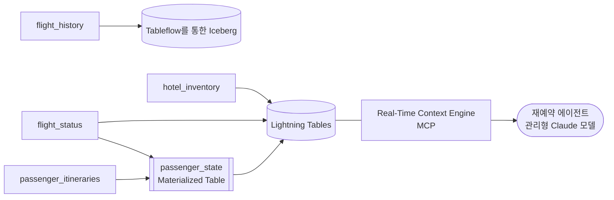
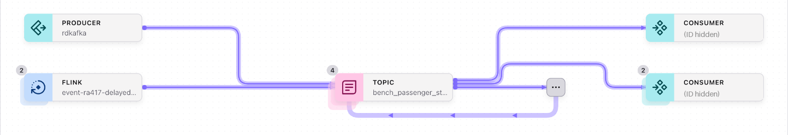

## Streamhouse의 구성

Confluent는 Kafka 토픽 위에 네 가지 관리형 계층을 조합해 Streamhouse를 구성한다.
Kafka 토픽은 이벤트를 보관하고 Schema Registry는 스키마를 관리한다.
Flink SQL은 주로 Materialized Table을 이용해 이벤트를 지속적으로 최신 상태로 변환한다.
Lightning Tables는 토픽의 최신 상태를 빠르게 읽을 수 있게 한다. 애플리케이션은 API로, 에이전트는 MCP 서버인 Real-Time Context Engine으로 접근한다.
Tableflow는 같은 토픽을 Iceberg 테이블로 기록하므로 히스토리를 위한 별도 파이프라인이 필요 없다.

각 계층은 Kafka 토픽으로 데이터를 교환한다. 따라서 derived state의 정의를 serving database나 export pipeline에서 다시 구현하지 않고 Flink에 유지할 수 있다.

## River Air 시나리오

Confluent quick start는 가상의 항공사 River Air를 사용한다.
시카고에서 출발한 RA417편이 샌프란시스코에 늦게 도착한다.
시스템은 연결편을 놓칠 위험이 생긴 승객을 찾고, AI 에이전트가 각 승객에게 대체 항공편 두 개와 필요한 경우 호텔을 제안하며, 과거 지연에 관한 질문에도 답해야 한다.

다음은 최근 한 시간 동안 실험 클러스터의 Stream Lineage를 요약한 콘솔 화면이다.

*Confluent Cloud 콘솔, 2026-11-15. 클러스터 개요의 기간은 “Last hour”이며 consumer ID는 가렸다.*

요약 화면은 여러 노드를 묶고 배지에 개수를 표시한다.
왼쪽 writer 가운데 `rdkafka`는 벤치마크 데이터 생성기이고, Flink `INSERT` 문 두 개는 RA417 이벤트를 재생했다.
가운데에는 토픽 네 개가 있다.
`…` 노드의 툴팁에는 “flink · 2”라고 표시된다. 토픽을 읽고 다시 토픽에 쓰는 Flink 노드가 두 개라는 뜻이다.
이 실험에서 두 동작을 모두 하는 것은 Materialized Table 두 개뿐이므로 해당 노드라고 판단했다.
오른쪽 consumer는 환경의 관리형 작업 이름으로 표시되며, 요약 화면만으로는 어느 서비스에 속하는지 알 수 없다.

Lineage에는 최근 트래픽만 나타나므로 화면을 캡처하기 직전에 이벤트 몇 개를 다시 보냈다.
Essentials governance package를 사용하는 이 환경에서는 전체 Stream Lineage 페이지가 온보딩 화면만 표시했다.

## 실험 환경의 구축 방식

[Quick start](https://github.com/confluentinc/quickstart-streamhouse)는 콘솔에서 30분 안에 따라 하는 안내서다.
나는 비용이 발생하기 전에 모든 단계를 검토할 수 있고, 매일 저녁 폐기한 뒤 다음 날 다시 구축할 수 있는 환경을 원했다.

Terraform은 환경 하나, 클러스터 하나, Flink compute pool 하나, 키를 포함한 서비스 계정 두 개, Lightning Tables, Tableflow table을 관리한다.
Lightning Tables와 Tableflow는 Flink가 먼저 생성하는 토픽이 필요하므로 변수로 활성화한다.

Flink 객체는 파일 하나에 statement 하나씩 SQL로 저장한다. 작은 CLI가 Flink Statements API를 통해 정해진 순서로 적용한다.
`-- lab:mode=snapshot` 같은 헤더 주석이 있으면 해당 파일을 snapshot(batch) query로 실행한다.

Terraform과 API로 처리할 수 없는 한 곳에서는 Confluent CLI를 사용했다.
Terraform에는 아직 `MCP_SERVER` connection type이 없으므로 에이전트의 MCP connection은 `confluent flink connection create`로 만든다.

오프라인 unit test 137개가 SQL 파일, 클라이언트, secret 처리, 벤치마크 도구를 검사한다. 클라우드에 연결하지 않고 모든 변경에서 실행된다.
기능별 live test 여섯 개는 실제 배포에서 quick start의 예상 결과를 확인하며 약 3분이 걸린다.

Quick start에서 두 가지를 변경했다.

| Quick start | 이 실험 | 이유 |
|---|---|---|
| Standard cluster | Basic cluster | 여기서 사용한 모든 기능이 Basic에서 동작하고 첫 eCKU가 무료다. Standard는 eCKU-hour당 $0.75부터 시작한다. |
| 사용자 자신의 Global API key | Terraform이 생성한 전용 서비스 계정의 Global API key | 사용자에게 허용된 Global key 두 개를 비워 두고 키 수명 주기를 코드로 관리한다. |

두 번째 변경에서 이 프로젝트의 가장 흥미로운 문제가 생겼다. 자세한 내용은 [Chapter 2](02-basic-clusters-and-read-only-agents.md)에 있다.

## 문서를 신뢰하기 전에 검증하기

읽은 내용 중 일부는 이미 현재 동작과 달랐다. 추측하지 않고 다음 항목을 직접 확인했다.

- Lightning query API는 `query/v1`에 있다. upstream quick start 저장소는 아직 `query/v1alpha1`을 호출한다.
- upstream 저장소에는 Terraform이 Global API key를 만들 수 없다고 적혀 있지만 provider 2.95.0은 만들 수 있다.
- 토픽에서 Lightning Table과 Real-Time Context Engine을 각각 활성화해도 같은 API 객체인 `rtce-topics`가 생성된다. Terraform에서는 `confluent_rtce_topic`으로 관리한다.

## 검증을 통과한 기능

에이전트 출력을 포함한 여섯 기능 모두 quick start의 결과와 일치했다.

| # | 기능 | 결과 |
|---|---|---|
| 1 | 소스 테이블과 샘플 이벤트 | 일치 |
| 2 | bounded snapshot query로 실행한 Flink join | 일치 |
| 3 | `passenger_state` Materialized Table과 RA417 지연 | `P-001`, `P-002`가 `OK`에서 `AT_RISK`로 변경 |
| 4 | MCP를 통한 Lightning Tables | 권한 변경 후 일치 |
| 5 | Tableflow 히스토리 | Flink와 Iceberg 직접 조회 모두 일치 |
| 6 | 재예약 에이전트 | 두 승객 모두 `OFFER1=RA226;OFFER2=RA232;HOTEL=Harbor Point Hotel` |

## 비용 구조

유휴 플랫폼의 비용은 거의 없다.
트래픽이 없는 Basic cluster, statement가 없는 compute pool, Schema Registry Essentials에는 요금이 부과되지 않는다.
실행 중인 항목에 비용이 발생한다.

- Materialized Table은 continuous statement이므로 존재하는 동안 최소 Flink CFU 하나를 사용한다. 과거 서울 리전 청구서에서는 CFU-hour당 $0.2562였으며 하루 약 $6다. `us-east-1` 요금은 확인하지 않았다.
- Tableflow topic은 새 데이터가 없어도 활성화된 시간만큼 과금된다.
- Lightning Tables는 저장 공간에 항상 과금하고, 데이터가 들어오거나 쿼리가 실행될 때만 compute 비용을 부과한다.
- 에이전트는 실행할 때마다 model inference 비용이 발생한다.

모든 구성이 코드에 있으므로 작업 세션 사이에는 실험 환경을 철거했다. 이 실험을 가장 저렴하게 운영하는 방법이었다.
