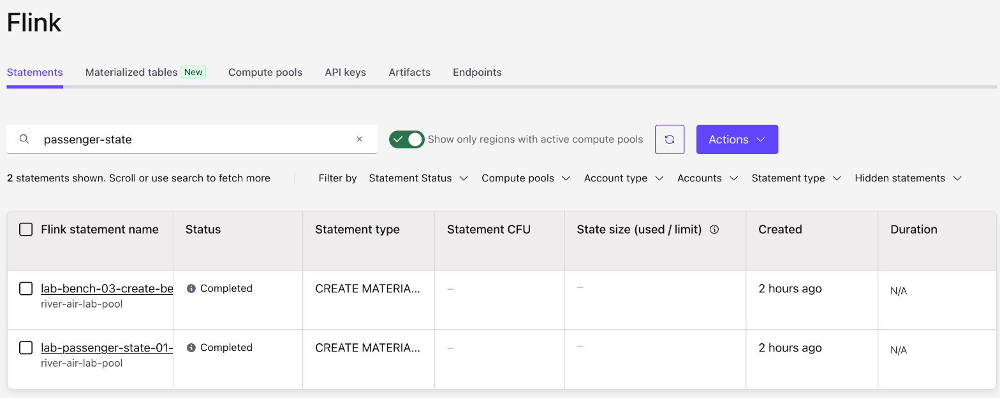
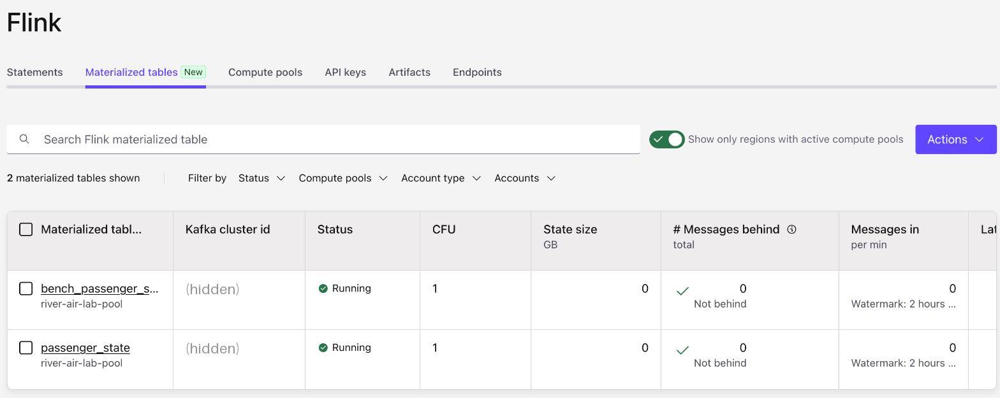
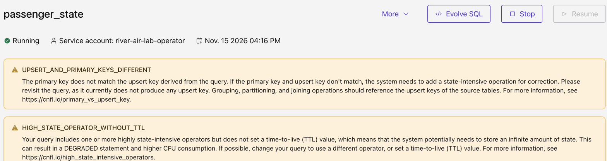

Confluent Cloud의 Flink Materialized Table은 테이블 정의, compaction이 설정된 backing topic, 스키마, 결과를 채우는 continuous query를 함께 소유하는 단일 객체다.
River Air의 `passenger_state`는 각 itinerary를 도착편과 연결편에 join하고, 승객마다 위험 상태를 포함한 행 하나를 유지한다.

```sql
CREATE MATERIALIZED TABLE passenger_state (
  PRIMARY KEY (passenger_id) NOT ENFORCED
)
DISTRIBUTED BY (passenger_id) INTO 1 BUCKETS
WITH ('changelog.mode' = 'upsert')
AS SELECT
  p.passenger_id,
  ...
  CASE
    WHEN p.connecting_flight_id IS NULL THEN 'NO_CONNECTION'
    WHEN TIMESTAMPDIFF(MINUTE, inbound.estimated_time,
                       onward.estimated_time) < 45 THEN 'AT_RISK'
    ELSE 'OK'
  END AS risk
FROM passenger_itineraries p
JOIN flight_status inbound ON p.inbound_flight_id = inbound.flight_id
LEFT JOIN flight_status onward ON p.connecting_flight_id = onward.flight_id;
```

문서에 설명된 대로 동작했다.
RA417편이 지연되자 정의를 변경하지 않았는데도 `P-001`, `P-002`가 `AT_RISK`로 바뀌었다.
다음 세 가지를 이해하는 데에는 시간이 더 걸렸다.

## 1. 실행 중인 쿼리는 statement 목록에 없다

제출 직후 `CREATE MATERIALIZED TABLE` statement는 `RUNNING`으로 표시됐다.
몇 분 뒤 bounded statement처럼 `COMPLETED`로 바뀌었다.
statement 목록에는 실행 중인 항목이 없었지만 테이블은 계속 갱신됐다.

콘솔도 두 항목을 분리한다.
Statements 탭에서는 quick start용과 부하 테스트용 Materialized Table이 완료된 `CREATE MATERIALIZED TABLE` statement로만 보인다.

[](../assets/flink-statements-mt-completed.png)

옆의 Materialized tables 탭에서는 두 테이블이 각각 1 CFU를 사용하며 실행 중이다.

[](../assets/flink-mt-running.png)

*Confluent Cloud 콘솔, 2026-11-15. 클러스터 ID 열은 가렸다. 이미지를 누르면 원본 크기로 볼 수 있다.*

API에서는 continuous query를 `GET /sql/v1/.../materialized-tables`에서 조회한다. 이 API는 자체 phase, version, `stopped` flag를 반환한다.

```
materialized tables (continuous queries; billed while RUNNING):
  RUNNING    passenger_state v1
```

Stream Lineage에는 source topic과 output 사이의 Flink node로 표시된다. [Chapter 1](01-the-lab.md)에 화면이 있다.

statement 목록만 사용해 Flink를 모니터링하거나 정리하면 24시간 과금되는 부분을 놓치게 된다.
실험 환경의 status command는 이제 두 목록을 모두 읽는다.

## 2. 공식 예제에 CRITICAL 경고가 두 개 있다

Materialized Table API는 경고도 반환한다.
문서에서 그대로 복사한 quick start 쿼리에는 둘 다 `CRITICAL`인 경고 두 개가 있었다.

- `UPSERT_AND_PRIMARY_KEYS_DIFFERENT`: 선언한 primary key인 `passenger_id`와 Flink가 쿼리에서 유도한 upsert key가 다르다. Flink는 상태를 많이 사용하는 보정 단계를 추가한다.
- `HIGH_STATE_OPERATOR_WITHOUT_TTL`: 일반 join에 time-to-live가 없어 상태를 영구 보관한다. statement 성능이 저하되고 CFU 사용량이 증가할 수 있다.

콘솔은 테이블 페이지 상단에 두 경고를 모두 표시한다.

[](../assets/flink-mt-warnings.png)

승객 세 명으로 실행한 실험에서는 경고로 인한 문제가 보이지 않았지만 Materialized Table은 여전히 유료 CFU 하나를 사용했다.
프로덕션 규모라면 각각 해결해야 한다. 유도된 upsert key와 선언한 primary key가 일치하도록 쿼리나 key를 다시 설계하고, join 상태의 상한을 두도록 state TTL을 추가해야 한다.
이를 위해 Materialized Table을 바꾸는 데에도 대가가 따르며, 4절에서 측정했다.

## 3. Freshness를 결정하는 설정

확정된 table option에는 다음 값이 포함된다.

```
'confluent.sink.buffer-flush.enabled'  = 'true'
'confluent.sink.buffer-flush.interval' = '5 s'
'kafka.cleanup-policy'                 = 'compact'
'key.format'                           = 'avro-registry'
'value.format'                         = 'avro-registry'
```

flush가 5초이므로 downstream reader도 몇 초 안에 변경을 볼 것으로 예상했다.
실제 측정에서는 derived state가 약 1분 간격으로 Lightning Tables에 나타났다.
Confluent의 [delivery guarantees 문서](https://docs.confluent.io/cloud/current/flink/concepts/delivery-guarantees.html)에 따르면 기본 exactly-once mode에서 Flink는 output transaction을 약 1분에 한 번 커밋한다. Lightning을 포함해 커밋된 데이터만 읽는 reader는 이 커밋을 기다린다.
[Chapter 6](06-how-fresh-is-real-time.md)에서 각 단계를 측정했다.

## 4. 중지하고, 바꾸고, 잘못된 레코드를 넣어 보기

이 테이블의 부하 시험용 복사본 `bench_passenger_state`에 생성한 승객 100,000명을 넣고, Flink가 보고하는 상태와 Lightning이 반환하는 값을 함께 지켜보며 세 가지를 시험했다.

### 중지와 재개

중지는 2초도 안 걸렸고 테이블은 `STOPPED`가 됐다.
이후 2분 30초 동안 항공편을 계속 바꿨다.
Lightning은 source topic의 변경은 바로 반환했지만 derived 행은 이전 값을 계속 반환했고, 두 Lightning Table 모두 `ACTIVE`였다.

재개 후 `RUNNING`까지 8초, 마지막 변경이 Lightning에 반영되기까지 그 뒤로 73초가 걸렸다. commit 주기 한 번을 조금 넘는 시간이다.
잃어버린 데이터는 없었다. 중지 전과 재개 후의 위험 분류 개수가 generator의 예측과 정확히 일치했다.

### CREATE OR ALTER로 쿼리 바꾸기

연결편이 없는 승객 15,024명을 제외하는 filter `WHERE p.connecting_flight_id IS NOT NULL` 하나를 추가했다.

첫 시도는 "Changing distribution of materialized table is not supported."로 실패했다.
원래의 `DISTRIBUTED BY` 절을 글자 그대로 다시 적었기 때문이다. 이 절을 빼자 성공했고 15초 뒤 version 2가 실행됐다.

이어서 두 가지가 일어났다. [문서](https://docs.confluent.io/cloud/current/flink/concepts/materialized-tables.html)도 둘 다 설명한다. 더 엄격한 filter가 남기는 "zombie" 행, 그리고 모든 처리 상태를 버린다는 점이다.

- 제외된 승객 15,024명은 output topic과 Lightning에 그대로 남았다. upsert mode에서는 새 쿼리가 더 이상 만들지 않는 key에 대해 delete를 보내지 않는다.
- 테이블에 이미 있던 승객은 더 이상 갱신되지 않았다. 변경 후 항공편을 지연시키자 Lightning은 새 항공편 시각을 반환했지만, 6분 뒤에도 그 항공편 승객은 이전 도착 시각을 보였다. 새 version은 join 상태 없이 시작해 이전 version이 멈춘 지점부터 source를 읽는다. 그래서 그 전에 쓰인 itinerary를 본 적이 없고 항공편 변경과 join할 대상이 없다. 항공편과 itinerary를 모두 변경 후에 쓴 승객은 14초 만에 나타났다.

실행 중인 테이블의 쿼리를 바꾸는 일은 새 데이터만 아는 새 테이블을 시작하는 것에 가깝다.
기존 key를 다시 만들려면 source를 처음부터 다시 처리해야 하며, 이것은 시험하지 않았다.

### 아무도 읽을 수 없는 레코드

`bench_flight_status`에 key는 정상이고 value는 Avro가 아닌 레코드 하나를 썼다. serializer를 잘못 설정한 producer가 쓸 법한 레코드다.
이 topic을 읽는 세 reader는 각각 다르게 반응했다.

| Reader | 일어난 일 |
|---|---|
| Materialized Table | 30초 안에 topic, partition, offset을 명시하며 `FAILED` |
| Lightning, source topic | 레코드를 건너뛰고 `ACTIVE` 유지, 1분 뒤 정상 write도 반환 |
| Lightning, derived table | `ACTIVE`를 유지했지만 그때부터 갱신 멈춤 |
| Tableflow | 약 2분 뒤 `FAILED`, suspended: "Contact support if you need help resolving this." |

Materialized Table 복구는 문서의 설정만으로는 되지 않았다.
읽을 수 없는 레코드를 dead letter table로 보내는 `ALTER TABLE bench_flight_status SET ('error-handling.mode' = 'log')`를 적용한 뒤 중지와 재개를 했지만 같은 offset에서 다시 실패했다.
`CREATE OR ALTER`를 한 번 더 실행하자 복구됐지만 위와 같은 상태 손실이 따랐고, 1분 뒤 확인했을 때 dead letter table은 비어 있었다.
Tableflow는 error handling을 `SKIP`으로 바꾸자 스스로 복구됐다.

세 경우 모두 데이터를 읽는 사람은 이상을 알아챌 수 없었다. Lightning은 계속 답했지만, 멈춘 상태로 답했다.
나라면 Lightning의 상태가 아니라 Materialized Table의 phase와 가장 최근 행의 나이에 경보를 걸겠다.

## 그 밖의 참고 사항

- 같은 join을 bounded snapshot query로 실행한 복사본은 약 10초 만에 끝났고 상태 관련 경고도 없었다. 탐색 단계에서는 snapshot query를 사용하고 결과를 계속 최신으로 유지해야 할 때만 Materialized Table로 만들겠다.
- Materialized Table은 존재하는 동안 최소 CFU 하나의 비용이 발생한다. 삭제하지 않고도 API 또는 Terraform의 `stopped = true`로 중지할 수 있다. SQL에는 `ALTER MATERIALIZED TABLE ... SUSPEND`가 있지만 재개하는 방법은 없다.
