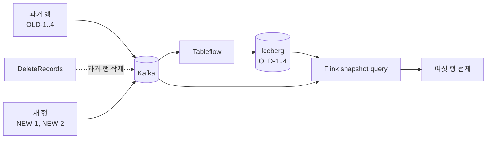

## 당연해 보이는 검증이 아무것도 증명하지 못하는 이유

Tableflow는 Kafka topic을 Iceberg table로 구체화한다.
Confluent Cloud에서 Tableflow를 활성화한 topic에 Flink snapshot query를 실행하면 오래된 데이터는 Iceberg snapshot에서, 최신 레코드는 Kafka에서 읽는다. 따라서 한 쿼리가 과거와 현재를 함께 다룬다.

Quick start는 `flight_history`에 snapshot query를 실행해 이를 확인한다.

```
flight_id  flights  delayed  impacted
RA214      1        1        64
RA210      1        1        18
RA417      4        1        120
```

Tableflow를 활성화하기 전과 후 모두 정확히 이 결과를 얻었다.
하지만 레코드가 생성된 지 몇 분밖에 지나지 않아 Kafka에 그대로 남아 있었다. Tableflow가 동작하지 않아도 같은 결과가 나오므로 Iceberg에 관해서는 아무것도 증명하지 못한다.

## 증거 1: Iceberg table 직접 읽기

Tableflow는 환경마다 Iceberg REST catalog를 제공한다.

```
https://tableflow.<region>.aws.confluent.cloud
  /iceberg/catalog/organizations/<org>/environments/<env>
```

Tableflow API key의 `key:secret`을 사용하는 OAuth2 client credential로 인증한다. 각 클러스터의 table은 cluster ID와 같은 이름의 namespace에 있다.
문서 예제는 container에서 Spark를 실행하지만 pyiceberg가 훨씬 가볍다.

```python
from pyiceberg.catalog.rest import RestCatalog

catalog = RestCatalog(
    "tableflow",
    uri=endpoint,
    credential=f"{key}:{secret}",
    **{"oauth2-server-uri": f"{endpoint}/v1/oauth/tokens"},
)
table = catalog.load_table((cluster_id, "flight_history"))
rows = table.scan().to_arrow()
```

pyiceberg의 암시적 fallback이 사라질 예정이라는 경고가 있어 `oauth2-server-uri`를 명시했다.

이 방식은 Flink나 Kafka를 거치지 않고 Iceberg를 읽는다.
Tableflow를 활성화한 지 약 4.5분 뒤 다음 결과가 나왔다.

```
format v2, 3 snapshots
  07:37:12Z  append
  07:37:13Z  append
  07:40:53Z  append

flight_id  flight_date  delay_minutes  affected_passengers  $$offset
RA417      2026-09-24   12             0                    0
RA417      2026-09-25   0              0                    1
RA417      2026-10-02   95             120                  2
RA210      2026-10-02   40             18                   3
RA417      2026-10-09   5              0                    4
RA214      2026-10-16   130            64                   5
```

Kafka offset 0부터 5까지 여섯 행이 있었고 원본과 정확히 일치했다.
이제 live test는 Flink aggregate와 Iceberg snapshot의 행을 모두 검사한다.

## 함께 확인한 동작

`flight_history`에는 primary key가 없어 Schema Registry에도 value schema만 있다.
[Tableflow overview](https://docs.confluent.io/cloud/current/topics/tableflow/index.html)는 key와 value에 모두 schema가 필요하다고 설명하지만 Tableflow는 이 topic을 문제없이 구체화했다.

Terraform은 5초 만에 Tableflow topic을 만들었고 약 1분 뒤 `RUNNING` 상태가 됐다.
첫 snapshot 두 개는 비어 있었고 활성화한 지 약 4.5분 뒤 세 번째 snapshot에 데이터가 들어왔다.
Managed storage 문서는 최초 구체화에 약 10분이 걸릴 수 있다고 설명한다.

Iceberg schema에는 `$$topic`, `$$partition`, `$$offset`, `$$timestamp`, `$$headers`, `$$raw-key`, `$$raw-value` 같은 metadata column이 추가된다.
`$$offset`을 사용하면 Iceberg와 Kafka를 행 단위로 대조할 수 있다.

Confluent Managed Storage에서는 table을 load할 때 만료 시간이 있는 임시 S3 credential을 받았다.
문서의 Spark 예제는 S3 remote signing을 켜지만 pyiceberg에는 필요하지 않았다.

Managed storage table은 전달받은 credential로 Tableflow catalog를 통해 접근하며 AWS Glue 같은 외부 catalog에는 동기화되지 않는다.
Iceberg REST Catalog와 vended credential을 지원하는 engine은 직접 query할 수 있다. Confluent 문서에서는 Athena for Spark를 예로 든다.
Glue catalog 연동이 꼭 필요하다면 자체 bucket을 사용해야 한다.

## 증거 2: 하이브리드 읽기를 강제로 만들기

Iceberg에 올바른 데이터가 있다는 것은 확인했지만 Flink가 Iceberg를 읽었다는 증거는 아직 없었다.
가장 명확한 검증 방법은 Kafka에서 데이터를 지운 뒤 Flink에 다시 묻는 것이다.

Confluent Cloud에서는 Kafka가 닫힌 log segment만 삭제하고 최소 `segment.ms`가 4시간이므로 retention을 기다리는 방식은 비효율적이다.
Kafka `DeleteRecords` API로 topic의 start offset을 기존 레코드 뒤로 옮기면 즉시 같은 상태를 만들 수 있다.

별도 table인 `hybrid_flight_history`에 과거 batch를 썼다. Tableflow가 약 4분 뒤 Iceberg에 기록한 것을 확인하고 Kafka record를 삭제한 다음 새 batch를 썼다.
각 단계에서 script가 topic 처음부터 읽는 Kafka consumer, pyiceberg를 통한 Iceberg table, Flink snapshot query를 검사했다.

| 단계 | Kafka | Iceberg | Flink snapshot query |
|---|---|---|---|
| 과거 batch 구체화 | OLD-1..4 | OLD-1..4 | OLD-1..4 |
| Kafka record 삭제 | 없음 | OLD-1..4 | OLD-1..4 |
| 새 batch 기록 | NEW-1, NEW-2 | OLD-1..4 | OLD-1..4, NEW-1, NEW-2 |



두 번째 단계에서는 Kafka에 데이터가 없는데도 Flink가 과거 행을 반환했으므로 Iceberg에서 읽은 것이 분명하다.
세 번째 단계에서는 Tableflow가 아직 따라잡지 못해 과거 행은 Iceberg에만, 새 행은 Kafka에만 있었다.
새 batch를 쓴 지 6.6초 뒤 snapshot query 하나가 여섯 행을 모두 반환했다. 어느 한쪽 저장소만으로는 만들 수 없는 결과다.

Kafka record를 삭제해도 Iceberg table에는 영향이 없었다. 따라서 topic의 retention을 짧고 저렴하게 유지하면서 query에는 전체 히스토리를 제공할 수 있다.

첫 시도에서는 코드가 `DeleteRecords` response의 잘못된 field를 읽어 삭제 직후 중단됐다.
삭제 자체는 성공했으므로 topic watermark를 확인하고 과거 batch를 다시 쓰지 않은 채 해당 상태에서 재개했다.
