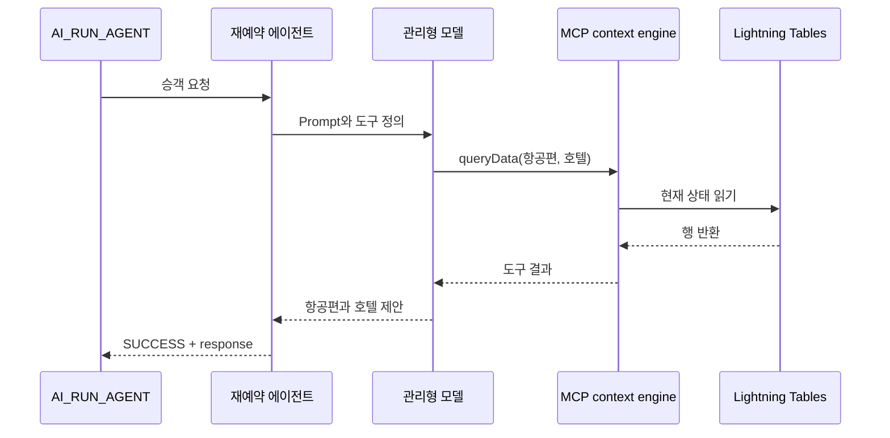

## 에이전트 구성

재예약 에이전트는 Flink SQL 객체 세 개와 connection 하나로 구성된다.

```sql
CREATE MODEL rebooking_model
INPUT (prompt STRING) OUTPUT (response STRING)
WITH ('provider' = 'confluent', 'task' = 'text_generation',
      'confluent.model' = 'anthropic.claude-sonnet-4-6');

CREATE TOOL river_air_live_context
USING CONNECTION `rtce-connection`
WITH ('type' = 'mcp',
      'allowed_tools' = 'getMetadata,queryData',
      'request_timeout' = '30');

CREATE AGENT rebooking_agent
USING MODEL rebooking_model
USING PROMPT '... offer the first two flights from SFO to the final
destination that leave at least 45 minutes after arrival, skip CANCELLED
flights, and add the first hotel alphabetically with rooms if an offer
leaves 6 or more hours later ... Reply with exactly one line:
OFFER1=<flight_id>;OFFER2=<flight_id>;HOTEL=<hotel or NONE>'
USING TOOLS river_air_live_context
WITH ('max_iterations' = '10');
```

관리형 모델은 Confluent Cloud 내부에서 실행되므로 별도의 endpoint나 API key가 필요 없다.
`us-east-1`의 `SHOW MODELS`에는 Claude Sonnet 4.6, Opus 4.6·4.7·4.8, Haiku 4.5, Amazon Nova 모델 세 개와 그 밖의 모델 두 개가 표시됐다.

도구는 Real-Time Context Engine의 MCP server이며 `getMetadata`, `queryData`만 허용했다.

Connection에는 MCP endpoint와 context reader의 Global API key가 들어 있다.
Terraform은 아직 이 connection type을 만들 수 없어 실험에서는 `confluent flink connection create`를 사용했다.



## Append-only 입력이라는 경계

`AI_RUN_AGENT`는 append-only 입력만 읽지만 `passenger_state`는 upsert table이다.
그래서 연결편을 놓칠 위험이 있는 승객을 append-only `rebooking_requests` table로 복사한 뒤 에이전트를 실행한다.

```sql
SELECT q.passenger_id, r.agent_status, r.response
FROM rebooking_requests AS q,
LATERAL TABLE(AI_RUN_AGENT(
  'rebooking_agent',
  CONCAT('passenger_id=', q.passenger_id,
         '; final_destination=', q.final_destination,
         '; inbound_arrival=', CAST(q.inbound_arrival AS STRING)),
  q.passenger_id
)) AS r(agent_status, response);
```

## 관측 결과

```
P-001  SUCCESS
  The first available hotel alphabetically is **Harbor Point Hotel**.

  OFFER1=RA226;OFFER2=RA232;HOTEL=Harbor Point Hotel

P-002  SUCCESS
  The first hotel alphabetically with available rooms is **Harbor Point Hotel**.

  OFFER1=RA226;OFFER2=RA232;HOTEL=Harbor Point Hotel
```

Quick start가 기대하는 답과 정확히 일치했다.
에이전트는 지연된 도착 시각에서 40분 뒤에 출발하는 RA214를 제외했다.
RA232가 다음 날 아침에 출발하므로 호텔을 추가했고, 객실이 모두 팔린 Airport Bayfront Inn은 건너뛰었다.
Prompt에는 항공편이나 호텔 데이터가 없으므로 이 정보는 모두 Lightning 실시간 조회에서 얻었다.

## 변경을 보는가

위 답은 멈춰 있는 데이터에서 나왔다.
에이전트가 실행 시점의 상태를 읽는지 보려고 데이터를 스무 번 바꿨다.

매 주기마다 RA214를 정시로 되돌리고, Lightning이 그렇게 반환할 때까지 기다린 뒤, 15:30 출발을 16:00으로 지연시켰다.
이 변경 하나로 정답의 세 부분이 모두 바뀐다. RA214는 14:50 도착 70분 뒤에 출발하므로 첫 번째 제안이 되고, 6시간 뒤에 출발하는 제안이 없으므로 호텔이 필요 없다.

```
before  OFFER1=RA226;OFFER2=RA232;HOTEL=Harbor Point Hotel
after   OFFER1=RA214;OFFER2=RA226;HOTEL=NONE
```

에이전트는 지연을 쓴 뒤 0, 5, 15, 30초에 각각 다섯 번씩, 순서를 섞어 실행했다.

| | 실행 | 새 데이터로 답함 | 이전 데이터로 답함 | 제안 행 없음 | p50 | max |
|---|---|---|---|---|---|---|
| Flink 내부 에이전트(실행당 승객 2명) | 20 | 40개 중 40개 | 0 | 0 | 18.4초 | 22.9초 |

0초에 실행한 경우까지 모든 답이 새 데이터를 사용했다.
같은 주기에 별도의 poller는 이벤트의 Flink statement가 끝났다고 보고한 지 1초 안에, 첫 query에서 이미 Lightning이 지연을 반환하는 것을 확인했다.
에이전트는 실시간 상태를 읽었지만, 이 실행으로는 에이전트가 오래된 데이터로 답하는 구간을 보여 줄 수 없었다. Lightning이 가장 짧은 offset보다 빨랐기 때문이다.
그 반영 시간은 [Chapter 6](06-how-fresh-is-real-time.md)에서 직접 측정했다.

## 운영상의 한계

Prompt에서 정확히 한 줄로 답하라고 했지만 40개 답변 모두 앞에 추론 문장을 붙였다. Quick start에도 이 문제가 경고로 적혀 있다.
응답을 사용하는 코드는 전체 field를 parsing하지 말고 `OFFER1=` 행을 찾아야 한다. 실험의 test도 그렇게 동작한다.

승객 두 명을 처리한 한 번의 실행은 종단 간 18–23초가 걸렸다. snapshot query 시작, model call, MCP call이 모두 포함된 시간이다.
`AI_RUN_AGENT`는 선택적인 네 번째 인자로 system log table을 받고, 실행 중의 모든 model call과 tool call을 거기에 기록한다.
이 table을 붙여 보니 40개 답변 모두 model call 세 번과 tool call 세 번으로 이뤄졌다.

에이전트의 도구는 읽기 전용이지만 credential의 권한은 더 넓다.
Basic 클러스터에서는 context reader key가 `CloudClusterAdmin`을 갖는다([Chapter 2](02-basic-clusters-and-read-only-agents.md)).

CLI로 connection을 만들면 secret이 SQL history에 남지 않고 `confluent flink connection describe`도 이를 반환하지 않는다.
다만 CLI는 secret을 command-line argument로 받으므로 로컬 프로세스 목록에 잠시 나타난다.

## Connection이 사라지면

실행이 시작되고 5초 뒤에 에이전트의 MCP connection을 삭제했다.
그 실행은 27초 뒤에 정상적으로 끝났고 답도 맞았다.
다음 실행은 1초도 안 돼 실패했는데, 오류가 엉뚱한 대상을 가리켰다.

```
Agent '`river-air-lab`.`river-air`.`rebooking_agent`' does not exist.
```

에이전트는 그대로 있었다.
같은 이름으로 connection만 다시 만들자 에이전트, 도구, 모델을 건드리지 않고도 다음 실행이 성공했다.
이 오류가 보이면 에이전트를 다시 만들기 전에 도구가 쓰는 connection부터 확인해야 한다.

## 같은 데이터를 읽는 외부 MCP 클라이언트

권한이 있는 MCP client라면 누구나 Lightning Tables를 읽을 수 있다. Flink 내부 agent는 그중 하나일 뿐이다.
비교를 위해 같은 스무 주기 동안 같은 작업을 Claude Code에서 headless로 실행했다.
Claude Code에는 에이전트의 prompt를 system prompt로, 같은 모델(`claude-sonnet-4-6`)을 주고, 내장 도구는 모두 끄고 같은 context 도구 두 개만 허용했다.

| | 실행 | 새 데이터로 답함 | 제안 행 없음 | tool call | p50 | max |
|---|---|---|---|---|---|---|
| Claude Code, 첫 실행 | 20 | 17 | 3 | 2–5 | 16.8초 | 20.6초 |
| Claude Code, `listTopics` 숨김 | 20 | 20 | 0 | 3 | 15.8초 | 20.3초 |

첫 실행의 실패 세 번은 내 설정 탓이었다.
Engine은 세 번째 도구 `listTopics`도 제공하는데, Flink 도구는 `allowed_tools`로 이를 뺀다.
Claude Code는 이 도구를 허용하지 않은 채 모델에게 보여 줬고, 모델이 호출하자 실행을 멈추고 권한을 요청했다.
두 에이전트가 같은 두 도구만 보도록 숨기자 해결됐다.

같은 모델과 도구에서 두 에이전트는 같은 답을 냈고 답변마다 같은 세 번의 tool call을 했다.
차이는 실행 방식에 있다. Flink 에이전트는 요청 table 위의 statement로 Confluent 청구서에 과금되고 table에 로그가 남는다. Claude Code는 직접 실행하고 보안을 챙겨야 하는 process이며 여기서는 답변당 약 $0.035였다.
둘 다 각자의 복사본 대신 지속적으로 유지되는 하나의 table을 읽는다. Streamhouse가 제공하려는 것이 바로 이 공유 상태다.
