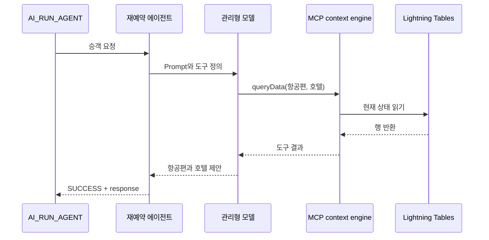

## 에이전트 구성

재예약 에이전트는 Flink SQL 객체 세 개와 connection 하나로 구성된다.

```sql
CREATE MODEL rebooking_model
INPUT (prompt STRING) OUTPUT (response STRING)
WITH ('provider' = 'confluent', 'task' = 'text_generation',
      'confluent.model' = 'anthropic.claude-sonnet-4-6');

CREATE TOOL river_air_live_context
USING CONNECTION `rtce-connection`
WITH ('type' = 'mcp',
      'allowed_tools' = 'getMetadata,queryData',
      'request_timeout' = '30');

CREATE AGENT rebooking_agent
USING MODEL rebooking_model
USING PROMPT '... offer the first two flights from SFO to the final
destination that leave at least 45 minutes after arrival, skip CANCELLED
flights, and add the first hotel alphabetically with rooms if an offer
leaves 6 or more hours later ... Reply with exactly one line:
OFFER1=<flight_id>;OFFER2=<flight_id>;HOTEL=<hotel or NONE>'
USING TOOLS river_air_live_context
WITH ('max_iterations' = '10');
```

관리형 모델은 Confluent Cloud 내부에서 실행되므로 별도의 endpoint나 API key가 필요 없다.
`us-east-1`의 `SHOW MODELS`에는 Claude Sonnet 4.6, Opus 4.6·4.7·4.8, Haiku 4.5, Amazon Nova 모델 세 개와 그 밖의 모델 두 개가 표시됐다.

도구는 Real-Time Context Engine의 MCP server이며 `getMetadata`, `queryData`만 허용했다.

Connection에는 MCP endpoint와 context reader의 Global API key가 들어 있다.
Terraform은 아직 이 connection type을 만들 수 없어 실험에서는 `confluent flink connection create`를 사용했다.



## Append-only 입력이라는 경계

`AI_RUN_AGENT`는 append-only 입력만 읽지만 `passenger_state`는 upsert table이다.
그래서 연결편을 놓칠 위험이 있는 승객을 append-only `rebooking_requests` table로 복사한 뒤 에이전트를 실행한다.

```sql
SELECT q.passenger_id, r.agent_status, r.response
FROM rebooking_requests AS q,
LATERAL TABLE(AI_RUN_AGENT(
  'rebooking_agent',
  CONCAT('passenger_id=', q.passenger_id,
         '; final_destination=', q.final_destination,
         '; inbound_arrival=', CAST(q.inbound_arrival AS STRING)),
  q.passenger_id
)) AS r(agent_status, response);
```

## 관측 결과

```
P-001  SUCCESS
  The first available hotel alphabetically is **Harbor Point Hotel**.

  OFFER1=RA226;OFFER2=RA232;HOTEL=Harbor Point Hotel

P-002  SUCCESS
  The first hotel alphabetically with available rooms is **Harbor Point Hotel**.

  OFFER1=RA226;OFFER2=RA232;HOTEL=Harbor Point Hotel
```

Quick start가 기대하는 답과 정확히 일치했다.
에이전트는 지연된 도착 시각에서 40분 뒤에 출발하는 RA214를 제외했다.
RA232가 다음 날 아침에 출발하므로 호텔을 추가했고, 객실이 모두 팔린 Airport Bayfront Inn은 건너뛰었다.
Prompt에는 항공편이나 호텔 데이터가 없으므로 이 정보는 모두 Lightning 실시간 조회에서 얻었다.

## 운영상의 한계

Prompt에서 정확히 한 줄로 답하라고 했지만 두 실행 모두 앞에 문장을 하나 붙였다. Quick start에도 이 문제가 경고로 적혀 있다.
응답을 사용하는 코드는 전체 field를 parsing하지 말고 `OFFER1=` 행을 찾아야 한다. 실험의 test도 그렇게 동작한다.

승객 두 명을 처리한 한 번의 실행은 종단 간 24–26초가 걸렸다. snapshot query 시작, model call, MCP call이 모두 포함된 시간이다.
결과에는 에이전트가 도구를 몇 번 호출했는지 나오지 않으므로 단계별 시간을 측정하려면 다른 관측 수단이 필요하다.

에이전트의 도구는 읽기 전용이지만 credential의 권한은 더 넓다.
Basic 클러스터에서는 context reader key가 `CloudClusterAdmin`을 갖는다([Chapter 2](02-basic-clusters-and-read-only-agents.md)).

CLI로 connection을 만들면 secret이 SQL history에 남지 않고 `confluent flink connection describe`도 이를 반환하지 않는다.
다만 CLI는 secret을 command-line argument로 받으므로 로컬 프로세스 목록에 잠시 나타난다.

## 외부 MCP 클라이언트

권한이 있는 MCP client라면 누구나 Lightning Tables를 읽을 수 있다. Flink 내부 agent는 그중 하나일 뿐이다.
같은 endpoint와 key를 Claude Code에 설정하면 같은 승객 상태를 읽을 수 있지만 이 실험에서는 비교 실행을 하지 않았다.
애플리케이션과 에이전트가 각자의 복사본 대신 지속적으로 유지되는 하나의 table을 사용하는 것이 Streamhouse가 제공하려는 공유 상태다.
