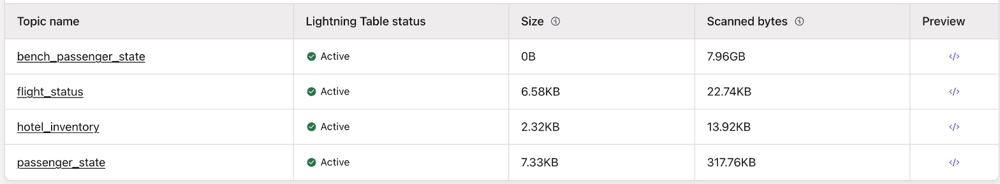

[Lightning Tables 문서](https://docs.confluent.io/cloud/current/lightning-tables/overview.html)는 새 데이터가 topic에 도착하면 100 ms 안에 table이 갱신된다고 설명한다. 이 수치는 serving layer만 포함한다.
Confluent의 [delivery guarantees 문서](https://docs.confluent.io/cloud/current/flink/concepts/delivery-guarantees.html)는 Flink가 약 1분마다 Kafka transaction을 커밋한다고 설명한다. 기본 exactly-once guarantee에서는 consumer가 읽는 output을 만드는 statement마다 최대 약 1분이 추가된다.
애플리케이션에는 source 변경부터 Flink를 거쳐 파생 상태를 읽는 전체 경로가 중요하므로 그 경로를 측정했다.

## 측정 환경

| 항목 | 값 |
|---|---|
| 리전 | AWS `us-east-1`, Basic cluster, 최대 5 CFU Flink pool |
| 데이터 | 고정 seed generator로 만든 항공편 1,021개와 승객 10,000명. quick start 데이터를 건드리지 않도록 별도 `bench_` table에 기록 |
| 검증 | bench Materialized Table이 예상 위험 상태와 정확히 일치: 6,387 OK, 2,103 AT_RISK, 1,510 NO_CONNECTION |
| 읽기 경로 | MCP를 통한 Real-Time Context Engine, client마다 장기 session 하나 |
| 클라이언트 | 서울의 laptop |
| Network | MCP host TCP 연결 190–210 ms, 실행 전후마다 측정 |

아래의 모든 지연 시간에는 태평양을 오가는 network round trip이 포함된다.
결과는 source topic과 Lightning 사이에 Materialized Table 하나가 있고 Flink의 기본 exactly-once delivery를 사용한 이 구성만 설명한다. Streamhouse의 일반적인 한계값이 아니다.
백분위수는 nearest-rank 방식이므로 모두 실제 관측값이다.

## 최신성 실험 설계

각 sample마다 client가 고유한 `estimated_time`을 가진 항공편 update를 Kafka producer(`acks=all`)로 쓰고 broker 승인 시각을 기록했다.
그다음 probe passenger의 `INBOUND_ARRIVAL`에 새 값이 나타날 때까지 `queryData`를 반복 호출했다.

각 sample은 두 시간을 기록한다.
“이전까지 보이지 않음”은 값을 놓친 마지막 poll의 시작 시각이고, “이때까지 보임”은 값을 처음 반환한 poll의 종료 시각이다.
실제 가시화 시점은 둘 사이다.
두 경계의 차이는 1.6–2.9초, 중앙값 1.8초로 측정 해상도에 해당한다. 서울에서 MCP query 한 번에 약 0.8초가 걸렸다.

## 첫 실행에 숨어 있던 벤치마크 함정

첫 30개 sample의 중앙값은 55.9초, 최댓값은 59.7초였다.
하지만 첫 sample만 17.4초였고 나머지 29개는 모두 52.5–59.7초였다.

가시화 시각이 원인을 보여 줬다. 08:02:58, 08:03:59, 08:05:01처럼 61–62초마다 하나씩 나타났다.
Runner는 이전 sample을 확인한 지 5초 뒤에 다음 sample을 썼다.
변경은 Flink commit 직후에만 보이므로 모든 쓰기가 commit 직후에 들어가 다음 commit까지 거의 전체 주기를 기다렸다.
측정 대상 시스템과 스스로 동기화되는 벤치마크를 만든 셈이다.

이 실행은 일반적인 최신성을 설명하지 않지만 두 가지는 보여 준다.
파생 상태는 약 61초 간격의 단계로 Lightning에 도착하고, commit을 막 놓친 쓰기는 가시화까지 약 56–60초가 걸린다.

수정 후에는 sample 사이에 5초와 고정 seed의 0–60초 난수 지터를 더해 쓰기 시점을 주기 전체에 분산했다.

## 종단 간 최신성 결과

지터를 적용한 30개 sample에서 broker 승인부터 Lightning 가시화까지의 결과다.

| min | p50 | p95 | max | mean |
|---|---|---|---|---|
| 17.8 s | 46.1 s | 66.9 s | 67.6 s | 42.4 s |

정렬한 30개 값: 17.8, 19.1, 20.6, 21.1, 23.9, 25.0, 30.0, 30.6, 32.6, 34.3, 36.1, 37.3, 38.8, 42.3, 46.1, 46.6, 47.4, 47.8, 48.6, 50.0, 50.2, 51.4, 52.4, 53.5, 53.7, 57.5, 59.5, 64.6, 66.9, 67.6.

61초 구간에 분산한 쓰기에서 예상할 수 있듯 값은 약 50초 범위에 퍼졌다.
두 실행 모두 최솟값이 17–18초였으므로 다음의 단순한 모델과 맞았다.

> 최신성 ≈ 고정 약 17초 + 다음 commit까지 0–약 61초 대기

아직 추정이었으므로 각 단계를 직접 측정했다.

## 단계별 최신성 분석

두 번째 실행에서는 같은 방식에 background thread의 Kafka consumer 두 개를 추가해 Materialized Table output topic을 읽었다.
하나는 `isolation.level=read_uncommitted`로 Flink write를 즉시 보고, 다른 하나는 `read_committed`로 transaction commit 뒤에만 본다.
각 write를 Flink 기록, commit, Lightning serving의 세 시점에서 관측했다.

Broker 승인 이후 초 단위 결과이며 30개 sample 모두 오류가 없었다.

| 단계 | min | p50 | p95 | max | mean |
|---|---|---|---|---|---|
| Flink가 출력 기록 | 0.2 | 2.6 | 4.8 | 5.0 | 2.7 |
| 출력 커밋 | 11.3 | 38.5 | 61.1 | 61.8 | 36.7 |
| Lightning에서 가시화 | 17.5 | 44.3 | 66.9 | 68.2 | 42.8 |

<figure class="benchmark-chart benchmark-chart--timeline" aria-labelledby="freshness-chart-title-ko">
  <figcaption id="freshness-chart-title-ko"><strong>Broker 승인 이후 누적 p50</strong><span>Lightning 가시화 44.3초를 축의 끝으로 사용했다.</span></figcaption>
  <div class="benchmark-axis" aria-hidden="true"><span></span><div><span>0</span><span>44.3 s</span></div><span></span></div>
  <div class="benchmark-chart__plot" aria-hidden="true">
    <div class="benchmark-row"><span>Flink 출력 기록</span><div><i class="bar--fresh-write"></i></div><strong>2.6 s</strong></div>
    <div class="benchmark-row"><span>출력 커밋</span><div><i class="bar--fresh-commit"></i></div><strong>38.5 s</strong></div>
    <div class="benchmark-row"><span>Lightning 가시화</span><div><i class="bar--full"></i></div><strong>44.3 s</strong></div>
  </div>
</figure>

Sample별 단계 사이의 차이는 다음과 같다.

| 구간 | min | p50 | max |
|---|---|---|---|
| 기록에서 commit까지 | 7.1 | 36.9 | 57.5 |
| commit에서 Lightning 가시화까지 | 3.2–5.0 | 4.4–6.1 | 5.3–7.1 |

Lightning 구간은 범위다. 첫 값은 commit 뒤 시작한 query가 여전히 행을 놓친 시점이고, 두 번째 값은 query가 처음 행을 반환한 시점이다.

Flink write 단계는 5초 sink flush와 일치한다. 입력 후 0–5초, 평균 2.7초에 output이 나타났고 broker timestamp만 사용해도 중앙값 2.5초였다.
대부분의 시간은 commit 대기였다. Commit된 output은 write 후 11–62초에 보였으며 문서의 약 1분 commit 및 첫 실행의 61초 간격과 맞는다. 30개 모두 Lightning은 commit 뒤에만 변경을 제공했다.

Commit 뒤 Lightning에는 3–7초가 더 걸렸다. 이 실험은 문서의 100 ms 목표가 시작되는 내부 데이터 도착 시점을 볼 수 없지만, transactional Flink output의 broker commit 가시성과 Lightning query 가시성 사이에 3–7초가 있었다는 것은 보여 준다.

따라서 첫 실험 E1의 “고정 17초”는 write 후 약 11초에 이뤄진 가장 빠른 commit과 Lightning의 약 5초를 합한 값이다.
두 실행의 전체 결과도 중앙값 44.3초와 46.1초로 일치한다.

**관측 결과.** Source 변경은 18–68초, 평균 약 42초 뒤에 파생 Lightning 상태로 나타났다. p50은 출력 기록 2.6초, commit 38.5초, Lightning 가시화 44.3초였다.

**설명된 부분.** 지연 대부분은 문서에 명시된 약 1분 간격의 exactly-once commit 대기다. `read_committed` consumer가 이를 직접 측정했으므로 join이나 serving query를 조정해도 줄어들지 않는다. 문서에는 commit interval 설정이 없고, Confluent가 지연을 줄이는 작업을 하고 있으며 더 짧은 지연이 필요하면 support에 문의하라고 안내한다.

**설명되지 않은 부분.** Commit과 Lightning 가시화 사이 3–7초가 어디에서 발생하는지는 알 수 없다. 문서의 100 ms는 데이터가 topic에 도착할 때 시작하지만 Confluent가 transactional output의 도착을 어느 시점으로 판단하는지는 이 실험에서 볼 수 없다.

**한계.** 서울 client에서 실행한 한 구성과 실행당 sample 30개의 결과다. at-least-once delivery, Flink statement가 여러 개인 pipeline, 리전 내부 client는 시험하지 않았다.

## 쿼리 형태별 지연 시간

MCP session 하나에서 세 형태를 번갈아 각각 100회 실행했다.

| 형태 | 행 | p50 | p95 | p99 | max |
|---|---|---|---|---|---|
| 단건 조회 | 1 | 689 ms | 788 ms | 874 ms | 1,360 ms |
| 동등 조건 filter | 200 | 697 ms | 817 ms | 1,205 ms | 1,261 ms |
| 범위 filter | 200 | 694 ms | 814 ms | 1,039 ms | 1,222 ms |

<figure class="benchmark-chart benchmark-chart--latency" aria-labelledby="latency-chart-title-ko">
  <figcaption id="latency-chart-title-ko"><strong>쿼리 형태별 지연 시간</strong><span>형태별로 번갈아 100회 실행한 p50과 p95, 900 ms 축.</span></figcaption>
  <div class="benchmark-chart__legend" aria-hidden="true"><span><i class="legend-p50"></i>p50</span><span><i class="legend-p95"></i>p95</span></div>
  <div class="benchmark-axis" aria-hidden="true"><span></span><div><span>0</span><span>900 ms</span></div><span></span></div>
  <div class="benchmark-chart__plot" aria-hidden="true">
    <div class="benchmark-row benchmark-row--paired"><span>단건 조회</span><div><i class="bar--point-p50"></i><i class="bar--point-p95"></i></div><strong>689 / 788 ms</strong></div>
    <div class="benchmark-row benchmark-row--paired"><span>동등 조건</span><div><i class="bar--equality-p50"></i><i class="bar--equality-p95"></i></div><strong>697 / 817 ms</strong></div>
    <div class="benchmark-row benchmark-row--paired"><span>범위 조건</span><div><i class="bar--range-p50"></i><i class="bar--range-p95"></i></div><strong>694 / 814 ms</strong></div>
  </div>
</figure>

10,000행의 `bench_passenger_state`에 실행한 query다.

```sql
-- point lookup (a random generated passenger each round)
SELECT * FROM bench_passenger_state WHERE PASSENGER_ID = 'B-P001234'
-- equality filter
SELECT PASSENGER_ID, CONNECTION_MINUTES FROM bench_passenger_state
WHERE RISK = 'AT_RISK' LIMIT 200
-- range filter
SELECT PASSENGER_ID FROM bench_passenger_state
WHERE CONNECTION_MINUTES BETWEEN 45 AND 90 LIMIT 200
```

**관측 결과.** 실패한 query는 없었고 중앙값은 모두 689–697 ms였다. 가장 느린 단건 조회는 실행의 첫 호출이었다.

**해석.** 10,000행에서는 세 query 형태의 차이보다 호출 자체의 비용이 컸다.

**한계.** 190 ms network round trip을 제외해도 약 500 ms가 남지만 MCP overhead와 Lightning engine 시간을 분리할 수 없다.

### Query가 스캔한 데이터

실험 뒤 Lightning Tables 콘솔에는 table별 스캔량이 표시됐다.

[](../assets/lightning-tables-scanned-bytes.png)

*Confluent Cloud 콘솔, 2026-11-15. E1, E3, E4 실행 뒤.*

기록된 실행은 `bench_passenger_state`에 약 5,830개 query를 보냈다. E1 poll 2,952개, E3 query 300개, E4 lookup 2,578개다.

**관측 결과.** 7.96 GB를 5,830으로 나누면 10,000행 table에서 query당 약 1.4 MB다. 대부분 primary key 단건 조회였다.

**가설.** 각 query가 key 하나로 바로 이동하지 않고 table의 대부분 또는 전체를 읽는 결과와 일치한다.

**한계.** 콘솔에는 table size가 0 B로 표시되고 Confluent는 lookup의 scan 방식을 문서화하지 않아 이 수치만으로 가설을 확인할 수 없다.

사실이라면 비용에 영향을 준다. Lightning compute는 CCU로 과금되며 [CCU 하나는 시간당 최대 80 GB scan을 포함한다](https://docs.confluent.io/cloud/current/ai/real-time-context-engine/billing.html). 여러 meter 가운데 가장 높은 것을 기준으로 과금한다.
이 규모에서는 한 시간 동안 약 8 GB라 저렴했다. Table이 10배 커졌을 때 스캔량도 함께 증가한다면 E4의 초당 40회 lookup은 시간당 약 2 TB를 스캔한다. 아직 측정하지 않았고 다음 실험은 100,000행이다.

### Lightning SQL이 허용하는 연산

Lightning SQL은 filter(`=`, `IN`, `LIKE`, `BETWEEN`, null check), `ORDER BY`, `LIMIT`을 지원한다. MCP로 최대 200행을 반환하고 aggregate, `GROUP BY`, join은 거부한다. 따라서 join과 aggregation은 Lightning Table보다 upstream인 Flink에서 처리해야 한다.

## 동시성에 따른 처리량

Closed loop 방식이다. N개 worker가 각자의 MCP session을 사용하며 이전 단건 조회가 끝나자마자 다음 요청을 보냈다. 동시성 단계마다 30초 동안 실행했다.

| 동시성 | 요청 | 처리량 | 오류 | p50 | p95 |
|---|---|---|---|---|---|
| 1 | 40 | 1.3 req/s | 0 | 694 ms | 1,182 ms |
| 2 | 86 | 2.9 req/s | 0 | 668 ms | 767 ms |
| 4 | 181 | 6.0 req/s | 0 | 636 ms | 702 ms |
| 8 | 354 | 11.8 req/s | 0 | 644 ms | 720 ms |
| 16 | 698 | 23.3 req/s | 0 | 646 ms | 743 ms |
| 32 | 1,219 | 40.6 req/s | 0 | 774 ms | 837 ms |

<figure class="benchmark-chart benchmark-chart--throughput" aria-labelledby="throughput-chart-title-ko">
  <figcaption id="throughput-chart-title-ko"><strong>동시 클라이언트 증가에 따른 처리량</strong><span>단건 조회 closed loop, 단계별 30초, 40.6 req/s 축.</span></figcaption>
  <div class="benchmark-axis" aria-hidden="true"><span></span><div><span>0</span><span>40.6 req/s</span></div><span></span></div>
  <div class="benchmark-chart__plot" aria-hidden="true">
    <div class="benchmark-row"><span>클라이언트 1개</span><div><i class="bar--c1"></i></div><strong>1.3 req/s</strong></div>
    <div class="benchmark-row"><span>클라이언트 2개</span><div><i class="bar--c2"></i></div><strong>2.9 req/s</strong></div>
    <div class="benchmark-row"><span>클라이언트 4개</span><div><i class="bar--c4"></i></div><strong>6.0 req/s</strong></div>
    <div class="benchmark-row"><span>클라이언트 8개</span><div><i class="bar--c8"></i></div><strong>11.8 req/s</strong></div>
    <div class="benchmark-row"><span>클라이언트 16개</span><div><i class="bar--c16"></i></div><strong>23.3 req/s</strong></div>
    <div class="benchmark-row"><span>클라이언트 32개</span><div><i class="bar--full"></i></div><strong>40.6 req/s</strong></div>
  </div>
</figure>

**관측 결과.** 클라이언트 16개까지 처리량이 선형으로 늘었다. 32개에서는 오류나 요청 제한 오류 없이 40.6 req/s였고 중앙값은 약 130 ms 증가했다.

**해석.** 클라이언트 32개의 결과는 선형 확장 시 예상되는 약 46 req/s보다 낮았다. 연결 양쪽 중 어느 한쪽에서 병목이 시작된 신호일 수 있다.

**한계.** 워커 32개가 서울 laptop의 한 Python 프로세스를 공유했다. 여러 프로세스 또는 리전 내부 클라이언트로 확인하기 전에는 서비스의 문제라고 단정할 수 없다.

## 다시 실행한다면 바꿀 점

Client를 리전 내부에서 실행하겠다. 서울에서는 약 690 ms 중 network round trip만 약 190 ms로 query 지연의 4분의 1을 넘는다.

벤치마크의 고정 지연도 의심하겠다. 무해해 보였던 지연이 sample을 Flink commit에 맞춰 버렸고, 원인을 찾은 뒤에는 난수 간격 한 줄로 해결했다.

각 sample의 양쪽 경계도 계속 기록하겠다. “이전까지 보이지 않음”과 “이때까지 보임”을 함께 기록한 덕분에 측정 해상도와 동기화 문제를 발견할 수 있었다.
